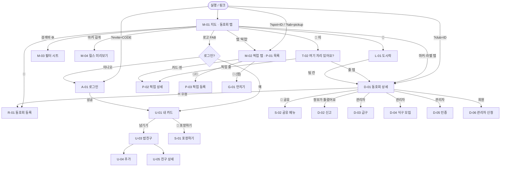

# 누룽지도 UI/UX 정의서 — 웹앱 · 네이티브 앱

> 웹앱(`null_oongzi-do`, Vanilla JS)과 Flutter 앱(`null_oongzi-do-app`)의 화면 하나하나를
> **사용자가 무엇을 보고, 무엇을 누르면, 어떻게 되는가**로 적은 문서다.
> 기준: 웹 main `48f6508` · 앱 main `87f9596`(2.13.0+24). 작성 2026-10-21, 양쪽 코드 전수 조사.
> 두 플랫폼은 같은 서비스다 — 다른 점은 각 장 안에 적고, 한데 모은 표는 §26.

## 0. 이 문서의 자리

| 알고 싶은 것 | 볼 문서 |
|---|---|
| 화면 구성·상태·문구·흐름 (이 문서) | `docs/ui-ux-spec.md` |
| 화면이 어떻게 움직이나(모션 이름·시간·곡선, 기능별 모션) | `docs/motion-spec.md` |
| 색·글꼴·모서리·그림자 숫자, 공유 카드 규격 | `docs/design-system.md` (숫자의 원본은 `tokens/design-tokens.json`) |
| 문구 말투 | `docs/voice-and-tone.md` |
| 기능이 양쪽에 다 있는가 | 앱 저장소 `docs/feature-parity.md` |
| 모양이 양쪽에 같은가 (반기 점검) | `docs/visual-parity.md` |
| 왜 이 기능이 있는가 | `docs/PHILOSOPHY.md` |
| 기능별 구현(함수·데이터 흐름) | `docs/map.md` · `filters.md` · `lunchbox.md` · `registration.md` · `auth.md` · `claims.md` |

**읽는 법**
- 문구는 KO 원문을 그대로 옮겼고 i18n 키를 `(key)` 또는 `[key]` 로 붙였다. 웹 키는 `js/i18n.js`, 앱 키는 `lib/l10n/strings.dart`. 같은 키라도 문구가 다를 수 있다(§21).
- 근거는 `파일:줄`. `W` = 웹 저장소, `A` = 앱 저장소(`lib/` 생략).
- 줄 번호는 기준 커밋 시점이다. 코드가 움직이면 함수 이름으로 찾는다.
- **고칠 때**: 화면을 바꾸면 이 문서의 해당 장도 같은 PR 에서 고친다. 웹·앱 한쪽만 바꾸면 §26 표에 줄을 더한다.

---

## 1. 서비스 한 줄과 사용자

- **한 줄**: 한국 배구 동호회·픽업 게임을 지도에서 찾고, 같이 뛸 팀을 담아 두는 앱. 슬로건 "우리 동네 배구, 여기서".
- **사용자**
  - 둘러보는 사람(비로그인): 지도·검색·상세·🍚 여기 자리 있어요?·공유·신고까지 쓴다.
  - 회원: 도시락(찜)·식단표·밥친구·포장하기(내 카드)·팀 등록.
  - 팀 관리자(팀마다 최대 3명): 팀 정보 수정·삭제, 게스트 급구, 식구 모집, 인증 신청.
  - 운영자: 모든 팀 수정·삭제, 소유자 지정, 대신 등록(픽업), 심사 페이지.
  - 외국인 사용자: EN 전환, 6인제·English OK 강조.
- **이름 체계(누룽지 은유)**: 도시락 = 찜한 팀 5칸, 식단표 = 그 팀들의 주간 시간표, 밥이름 = 자동으로 지어 주는 닉네임(밥 종류 25가지), 밥도감 = 나와 밥친구가 모은 밥 종류, 합석 = 밥친구와 같은 팀·같은 시간, 포장하기 = 내 카드 이미지 공유, 식구 모집 = 새 회원 모집, 맛보기 = 체험 환영, 게스트 급구 = 이번 운동에 급히 사람 구함.

---

## 2. 화면 지도

### 2-1. 화면 목록

형태: **전체** = 전체 화면/페이지 · **시트** = 바텀시트 · **팝업** = 가운데 카드 · **오버레이** = 지도 위에 떠 있는 층.

| ID | 화면 | 웹 형태 | 앱 형태 | 로그인 | 장 |
|---|---|---|---|---|---|
| M-01 | 지도 메인(동호회 탭) | 전체 | 전체 | — | §4 |
| M-02 | 지도 메인(픽업 탭) | 전체 + 하단 패널 | 전체 + 끌기 시트 | — | §4 · §10 |
| M-03 | 검색·필터 | 위에서 내려오는 시트 | 모달 시트 | — | §5 |
| M-04 | 릴스 미리보기(마커 길게) | 오버레이 | 오버레이 | — | §4-3 |
| M-05 | 앱 설치 배너 | 하단 띠(Android) | 없음 | — | §4-4 |
| D-01 | 동호회 상세 | 비모달 시트(peek/펼침) | 비모달 패널(peek/펼침) | — | §6 |
| D-02 | 정보가 틀렸어요(신고) | 팝업 | 팝업 | 익명 자동 | §6-5 |
| D-03 | 게스트 급구 올리기·수정 | 팝업 | 모달 시트 | 팀 관리자 | §7 |
| D-04 | 식구 모집 시작·수정 | 팝업 | 모달 시트 | 팀 관리자 | §8 |
| D-05 | 인증 신청 | 팝업(안내+파일) | 바로 갤러리 | 팀 관리자 | §19-2 |
| D-06 | 팀 관리자 신청 | 팝업 | 팝업 → 갤러리 | 회원 | §19-3 |
| T-01 | 🍚 여기 자리 있어요? 띠 | 지도 위 띠 | 지도 위 띠 | — | §9-1 |
| T-02 | 🍚 여기 자리 있어요? 목록 | 팝업 시트 | 모달 시트 | — | §9-2 |
| P-01 | 픽업 목록 | 하단 고정 패널 | 끌기 시트 | — | §10-1 |
| P-02 | 픽업 상세 | 목록 패널이 상세로 바뀜 | 같음 | — | §10-2 |
| P-03 | 픽업 등록·수정 | 팝업 | 전체(시트) | 익명 자동 | §11 |
| A-01 | 로그인·가입 | 🍚 팝업 안 | 전체 화면 | — | §12 |
| A-02 | 로그인 진행 레이어 | 오버레이 | 오버레이 | — | §12-B · §12-D |
| U-01 | 🍚 팝업 첫 장: 내 카드 | 팝업 | 팝업 | 회원 | §13 |
| U-02 | 이름 바꾸기 | 팝업(nzPrompt) | AlertDialog | 회원 | §13 |
| U-07 | 계정 삭제(회원 탈퇴) 확인 | 팝업(nzConfirm danger) | AlertDialog | 회원 | §13-D |
| U-03 | 🍚 팝업 둘째 장: 밥친구 목록 | 팝업 페이지 | 같음 | 회원 | §14-A |
| U-04 | 밥친구 추가(초대코드·QR) | 팝업 페이지 | 같음 | 회원 | §14-B |
| U-05 | 밥친구 상세(식단표 겹쳐 보기) | 팝업 페이지 | 같음 | 회원 | §14-C |
| L-01 | 도시락 + 식단표 | 팝업 | 팝업 | 웹 — / 앱 회원 | §15 |
| L-02 | 직접 담기 | 팝업 | 팝업 | 웹 — / 앱 회원 | §15-4 |
| S-01 | 포장하기 미리보기 | 오버레이(저장) | 전체(인스타·다른 앱) | 회원 | §16 |
| S-02 | 공유 메뉴 | 팝업 | 팝업 | — | §17 |
| S-03 | 스토리 링크 스티커 안내 | 팝업(처음 한 번) | 팝업(처음 한 번) | — | §17 |
| R-01 | 동호회 등록·수정 | 팝업 | 모달 시트 | 웹 제출 시 / 앱 열 때 | §18 |
| R-02 | 지도에서 위치 고르기 | 지도 위 모드 | 전체 화면 | — | §18-4 |
| R-03 | "여기가 맞나요?" 위치 확인 | 지도 위 패널 | 없음 | — | §18-3 |
| G-01 | 안치기 | 별도 페이지 `anchigi.html` | 전체 화면(픽업 탭 🏐) | — | §20 |
| X-01 | 개인정보처리방침·이용약관·운영 기준·데이터 삭제 | 별도 페이지 | 웹 링크 | — | §22 |
| X-02 | 운영자 심사 | `review.html` | 없음 | 서명 링크 | §19-5 |
| X-03 | 스플래시 | 없음 | 네이티브 첫 화면 | — | §23 |

### 2-2. 화면 흐름

**로그인이 끼어드는 곳**
- 웹: 프로필(🍚 팝업이 로그인 화면이 된다), 팀 등록 **제출**, 밥친구 초대 링크. 도시락은 로그인 없이 브라우저에 담는다.
- 앱: 도시락·프로필·상세의 🍱·동호회 등록을 **열 때** — 스낵바 "로그인하면 쓸 수 있어요"(`login_required`) 뒤 로그인 화면.
- 픽업 등록·신고는 양쪽 다 로그인 없이 익명 인증으로 처리한다.

### 2-3. 지도 화면의 층 (위에서 아래 순)

1. 팝업·확인창(nzConfirm / AlertDialog) — 가장 위, 토스트는 그보다도 위(웹 z 100001)
2. 모달 시트(필터·🍚 목록·급구·모집·등록)
3. 비모달 상세 시트/패널 — 지도는 계속 만질 수 있다
4. FAB · 검색바 · 탭 · 🍚 띠 (글래스 표면)
5. 앱 설치 배너(웹, 상세 시트에 가려짐)
6. 지도 · 마커 · 라벨 · 클러스터

---

## 3. 공통 UI 규칙과 컴포넌트

### 3-1. 토스트 / 스낵바

- **웹 `window.showToast(msg, {ms})`**
  - 화면 아래 가운데. 다크 브라운 `--nurungji-dark` 배경 + 크림 글자, 14px/600, 모서리 `--radius-toast` 12
  - `role=status aria-live=polite`. `\n` 줄바꿈 지원
  - 표시 시간: 2.4초 + 글자당 40ms, 최대 6초. 누르면 바로 닫힘
  - z-index 100001 (팝업보다 위)
  - 규칙: alert를 대신함. 삭제 확인이나 입력 실수에는 쓰지 않음. 오류 원문(e.message)은 붙이지 않음
  - 근거: `js/toast.js`, `css/main.css:875-902`
- **앱 SnackBar**: `snackBarTheme` floating, 같은 색·글꼴, 모서리 toast 12, 액션 색은 노랑. 화면마다 `_snack`/`_toast`로 호출 (`theme.dart:346-361`)

### 3-2. 입력 칸 오류 (field error)

- **웹 `window.fieldError(target, msg, {focus, after})`**
  - 칸에 빨간 테두리(`--error-color` #d32f2f) + 바로 아래 `.field-error` 13px/600 한 줄
  - `role=alert`, `aria-invalid`, `aria-describedby` 설정
  - 칸이 가로 flex 줄 안에 있으면 그 줄 뒤에 붙임
  - 접힌 `
` 안이면 펼치고, 스크롤해서 포커스를 옮김
  - 칸에 input/change/click이 생기면 저절로 사라짐. 대상 칸이 없으면 토스트로 대신함
  - `clearFieldError(s)` 제공
  - 근거: `js/field-error.js`, `css/main.css:2636-2660`
- **앱**
  - TextField: `InputDecoration.errorText` (errorBorder 빨강, `fieldErrorStyle` 13/600, 최대 3줄)
  - 칩·릴스처럼 칸이 아닌 묶음: `FieldErrorText` (`Semantics(liveRegion)`)
  - 묶음 라벨도 빨간색으로 바뀜 (`club_form_screen.dart:782-801`)
  - 근거: `widgets/field_error_text.dart`, `theme.dart:11-18,373-383`
- **흐름 단위 오류**(칸 하나에 묶이지 않는 것): 폼 상단 배너 (웹 `showRegError`, 앱 `_errorBanner`)

### 3-3. 팝업 (dialog)

- **웹 `nzConfirm({title,message,confirm,cancel,danger})` → Promise<boolean>**
- **웹 `nzPrompt({title,message,fields,confirm,cancel,validate})` → 값 객체 | null**
  - 모양: 갈색 딤 `--dim`, 흰 카드, 최대 400px, 모서리 20. 제목 17/800, 메시지 14 `pre-line`
  - 버튼: 취소 = `nz-btn-ghost`(chip 색), 확인 = `nz-btn-primary` 노랑. danger면 `--urgent-ink` 배경 + 흰 글자이고, **처음 포커스가 '취소'**에 감
  - 기본 라벨: "취소"(`dlg_cancel`), "확인"
  - 문구 규칙: 버튼에는 누르면 일어나는 일을 그대로 씀("팀 지우기", "빼기")
  - 바깥 클릭·Esc·폰 뒤로가기는 모두 취소. Tab 포커스는 팝업 안에서만 돎
  - `validate` 오류는 팝업을 닫지 않고 해당 칸에 `fieldError`로 표시
  - 근거: `js/dialog.js`, `css/main.css:904-998`
- **앱**: 공용 헬퍼 없이 화면마다 `AlertDialog`를 직접 만듦
  - `dialogTheme`: 흰 배경, 모서리 20, 제목 17/800, 본문 14/1.55
  - 글자 버튼은 다크 색. 위험한 작업은 `urgentInk` 글자 + w800
  - 근거: `theme.dart:312-345`, `detail_sheet.dart:808-830`

### 3-4. 바텀시트 셸

- **앱 `showAppSheet`**
  - `showModalBottomSheet`(드래그 핸들, `isScrollControlled`, 최대 높이 94%). 배경은 기본 크림 `light`, 등록 폼만 흰색
  - `SheetTitle`: 왼쪽 정렬, w800, 다크, `BowlText`
  - 테마: 상단 모서리 28, 딤 `NurungjiColors.dim`, 핸들 `#d8cfc6` 44×5
  - 근거: `widgets/app_sheet.dart`, `theme.dart:269-283`
- **웹 `.bottom-sheet`** (클럽 상세)
  - 흰 95% + blur 20, 상단 모서리 `--radius-sheet` 28, 갈색 그림자
  - 손잡이는 `<button>`(aria "닫기" `sheet_close`). 잡는 띠 높이 45px
  - 쓸어내리면 닫히고, 키보드나 화면 낭독기로는 손잡이를 누르면 닫힘
  - 근거: `index.html:298-327`, `css/main.css:1725-1760`

### 3-5. 글래스 표면, 눌림 효과, BowlText

- **GlassSurface** (앱)
  - 흰 85%(`glass`) 또는 크림 85%(`.cream`, blur 12, 모서리 24) + BackdropFilter blur 8
  - 흰 50% 1px 테두리 + 갈색 그림자 `NurungjiShadows.md`
  - 웹 `--glass-bg`, `--glass-bg-darker`와 짝 (`widgets/glass_surface.dart`)
- **BounceTap** (앱)
  - 누르면 0.94배로 줄어듦 (120ms, `easeOutBack`)
  - Listener라 자식의 탭을 가로채지 않음. `onTap`이 있으면 GestureDetector도 붙임
  - 거의 모든 탭 요소에 씀 (`widgets/bounce_tap.dart`)
  - 웹은 `:active { transform: scale(.94~.96) }`로 같은 효과 (`.lb-cell`, `.lb-edit-btn`, `.diet-toggle-btn`)
- **BowlText / setBowlText**
  - 문구가 `🍚`로 시작하면 이모지 대신 `assets/logo-512.png` 아이콘(그림은 글자 크기의 1.6배, 차지하는 자리는 1.45배)을 그리고 나머지 글자를 붙임
  - 웹은 `applyI18n`이 모든 `[data-i18n]`에 적용하고, 식구 모집 배지·플래그 버튼·이번주 스트립에도 씀
  - 앱은 SheetTitle·칩 라벨에 씀
  - 근거: 웹 `js/i18n.js:857-877`, 앱 `widgets/bowl_text.dart`

### 3-6. 칩과 버튼

- **칩**
  - 웹 `.chip`: 패딩 10/18, 모서리 20, 흰 80% + 갈색 30% 테두리, 14/600 #5d4037. `.selected`는 노랑 + w800 + 노랑 그림자
  - 앱 `chipTheme`: Stadium, 미선택은 흰 80% + `0x4D8D6E63` 테두리, 선택은 노랑. 체크 표시 없음
  - 근거: `css/main.css` `.chip`, `theme.dart:57-88`
- **버튼**
  - 앱 `Elevated` = 노랑/다크, 모서리 14, 패딩 14, 15/800
  - 앱 `Outlined` = 브라운 테두리
  - 앱 `TextButton` = 다크 15/700
  - 웹 `.nz-btn` = 모서리 `--radius-button` 14, 15/800
  - 웹 등록 제출 `.reg-submit-btn` = **브라운 + 흰 글자**(모서리 12). 앱 등록 제출은 노랑이라 다름

### 3-7. 디자인 토큰 (원본 `tokens/design-tokens.json` → 웹 `:root`, 앱 `design_tokens.g.dart`)

| 종류 | 값 |
|---|---|
| 색 | yellow `#fac710`(CTA), brown `#84675d`(보조·아웃라인), dark `#4e342e`(본문), bg `#fff8e1`(크림), light `#fffde7`(카드·시트), urgent `#ff7043`, urgentInk `#bf360c`(흰 글자 바탕), today `#cf4014`, error `#d32f2f`, chipBg `#f0ece2`, chipFg `#6d6258`, teal `#13a89e`(픽업), handle `#d8cfc6`, glass `rgba(255,255,255,.85)`, glassCream `rgba(255,248,225,.85)`, dim `rgba(93,64,55,.35)`(검정 금지) |
| 그림자 | md `0 8 32 rgba(93,64,55,.15)`, sm `0 4 12 rgba(93,64,55,.12)` (갈색) |
| 모서리 | sheet 28 · button 14 · input 12 · dialog 20 · toast 12 · fab 20 · fabProfile 24 |
| 글꼴 | Pretendard Variable (웹 `css/main.css:3`, 앱 `theme.dart` fontFamily `'Pretendard'`) |

---

## 4. 지도 메인 화면

**진입:** 앱을 실행하거나 웹 첫 화면을 열면 나옵니다. 딥링크 `?club=`, `?spot=`, `?tab=pickup&region=&level=&english=1`로도 착지합니다(W `js/app.js:45-108`).
**닫기:** 앱은 뒤로가기를 2초 안에 두 번 누르면 종료됩니다(§25).

### 4-1. 구성 (위→아래)

**검색바** (W `index.html:78-85`, A `map_screen.dart:2377-2476`)
- 🔎 아이콘 + 입력칸.
  - 동호회 탭 placeholder: "팀명, 지역으로 검색..." `[search_ph]`
  - 픽업 탭 placeholder: "픽업, 장소로 검색..." `[pk_search_ph]`. 웹은 `tabs.js:33`에서 실행 중에 바꿔 끼웁니다.
- 언어 토글: 바꿀 대상 언어를 보여줍니다. 지금 한국어면 `EN`, 영어면 `한`(W `i18n.js:899-901`, A `:2417`).
- 필터 버튼
  - 웹: `⚙️`와 빨간 점 배지 `#filterBadge`. 칩이 1개 이상 골라졌을 때만 켜지고, 키워드는 세지 않습니다(`filters.js:58-63`). 픽업 탭에선 숨깁니다(`tabs.js:38`).
  - 앱: `Icons.tune`. 필터가 비어 있지 않으면 아이콘이 urgent 색이 되고 점이 붙습니다. 이때는 키워드도 "필터"로 칩니다(`ClubFilter.isEmpty`). 툴팁 "검색·필터" `[search_filter]`.
  - 앱 픽업 탭에선 이 자리가 `Icons.language`(🌐) English OK 토글로 바뀝니다. 툴팁 "English OK만" `[english_only]`, 켜지면 teal 색(A `:2458-2472`).
- 로딩(앱만): 데이터를 읽는 동안 필터 아이콘 자리에 작은 원형 스피너가 돕니다(A `:2424-2432`). 웹에는 지도 로딩 표시가 없습니다.

**탭** (W `index.html:87-90` `[tab_clubs]` `[tab_pickup]`, A `_tabPill` `:2556`)
- 웹은 role=tablist 버튼 두 개입니다.
- 앱은 큰 글래스 알약 안에 작은 알약 두 개를 넣었고, 고른 쪽이 노란색입니다.

**결과 0 안내** (W `index.html:93-96`, A `_emptyResult` `:2609`)
- 문구: "조건에 맞는 팀이 없어요" `[empty_result]` + 버튼 "필터 지우기" `[empty_result_reset]`.
- 웹은 키워드나 칩이 있는데 보이는 마커가 0일 때 뜹니다(`filters.js:146-150`).
- 앱은 동호회 탭이고, 로딩이 끝났고, 오류가 없고, 필터가 비어 있지 않은데 맞는 팀이 0일 때 뜹니다(`:2602`).
- 토스트가 아니라 떠 있는 안내입니다(글자를 칠 때마다 다시 계산되기 때문).
- "필터 지우기"
  - 웹: `resetFilters()`.
  - 앱: `_clearFilter()`가 필터와 검색어를 비웁니다.

**🍚 여기 자리 있어요? 띠** — §9에서 자세히 다룹니다.

**FAB**
- 웹(`index.html:121-130`)
  - 🍱 `[fab_lunchbox]` "도시락"
  - 로고 이미지 `[fab_profile]` "프로필"
  - `.fab-group`:
    - 📝 `[fab_register]` "팀 등록하기". 픽업 탭에선 🏐 `[fab_pickup_create]` "픽업 등록"으로 바뀝니다.
    - 📍 `[fab_my_location]` "내 위치".
  - 픽업 탭에선 🍱와 프로필을 숨기고 `body.pickup-mode`로 FAB 묶음을 목록 위로 올립니다(`tabs.js:30-46`).
- 앱(`:2195-2224`)
  - 동호회 탭: 왼쪽 🍱(bottom 95)·프로필(로고 55px, bottom 30), 오른쪽 📝(노란 바탕, bottom 95)·📍(bottom 30).
  - 픽업 탭: 왼쪽에 🏐 안치기, 오른쪽에 📝·📍. 모두 목록 시트 peek 높이(42%)+14 위로 올라갑니다.
  - 픽업 탭에서도 앱 FAB은 📝입니다(웹처럼 🏐로 바뀌지 않음). 누르면 탭에 따라 픽업 폼이나 팀 폼이 열립니다.
  - 프로필 FAB에는 받은 밥친구 신청 수 배지(`9+`까지)와 따뜻함 단계 테두리가 붙습니다(`:2273-2343`).
  - FAB은 모두 Semantics label이 있고, 누르면 BounceTap 스프링으로 눌립니다.

**오류(앱만):** 화면 아래 빨간 상자에 "팀 정보를 불러오지 못했어요. 인터넷 연결을 확인해 주세요." `[data_load_err]`가 뜹니다(`:2833`). 웹은 콘솔 로그만 남기고 빈 지도를 보여줍니다(`data.js` catch).

### 4-2. 인터랙션

**검색 입력**
- 웹: `onkeyup` → `onSearchInput()`(`tabs.js:83-89`).
  - 동호회 탭은 `applyFilters()`로 이름·주소 포함 검색을 하고, 결과에 맞춰 `map.setBounds`로 화면을 맞춥니다.
  - 픽업 탭은 목록을 다시 그립니다.
- 앱: `onChanged` → `_onSearch`.
  - 동호회 탭은 `_filter.keyword`를 바꾸고 `_fitToFilter`로 화면을 맞춥니다. 결과가 0.01도보다 좁으면 줌 15로 고정합니다.
  - 바깥을 누르거나 키보드 검색 키를 누르면 키보드가 내려갑니다.

**언어 토글:** 웹은 `toggleLang()` 뒤에 `nurungji:langchange` 이벤트를 보내고, 열린 시트를 조용히(silent) 다시 그립니다.

**📍 내 위치**
- 웹: `navigator.geolocation` → 파란 GPS 마커를 찍고 `panTo`(`filters.js:234-246`). geolocation이 없으면 토스트 "이 기기에선 위치를 쓸 수 없어요" `[geo_unavailable]`. 권한을 거부하면 아무 반응이 없습니다(error 콜백 없음).
- 앱: 권한을 요청하고 `NLocationTrackingMode.follow`로 따라갑니다(`:182-189`). 거부하면 무시합니다. 지도가 준비되면 noFollow로 내 위치 점을 미리 켭니다.

**🍱 / 프로필**
- 앱은 로그인 가드를 거칩니다(`:192-219`). 비로그인이면 스낵바 "로그인하면 쓸 수 있어요" `[login_required]`를 띄우고 LoginScreen을 push합니다.
- 웹은 바로 엽니다. 도시락은 localStorage 폴백이 있고, 프로필 카드는 비로그인이면 로그인 섹션을 보여줍니다.

**📝 등록**
- 앱: 동호회 탭에서 비로그인이면 `registration_login_gate`를 남기고 로그인을 요구합니다. 픽업은 로그인 없이 열립니다(`:2009-2025`).

**탭 전환**
- 웹 `switchTab` (`tabs.js:56-80`): 상세 시트와 픽업 상세를 닫고 마커를 모두 걷은 뒤 화면 구성을 바꿉니다. 픽업으로 가면 `loadPickupGames()`로 다시 읽습니다.
- 앱 `_onTab` (`:1988`): 릴스 미리보기, 선택한 스팟, 상세 패널을 비웁니다.

### 4-3. 마커와 클러스터

**동호회 핀**
- 웹: `marker_yellow.png` 40×53(`map-core.js:26-33`). 급구 팀은 `marker_red.png`, zIndex 9999에 클러스터에서 빠지고 늘 보입니다.
- 앱: 기본 핀 38×48, 이름 알약이 붙으면 170×76입니다. 급구 팀은 빨간 핀에 클러스터 제외(`:1801-1818`).

**이름 라벨(알약)**
- 웹 `buildClubLabelEl` (`:63-102`)
  - 내용: [인증 SVG] + 상태 표시 `🔥`(급구)·`🍚`(식구 모집)·`🥄`(맛보기) + 이름 + 릴스가 있으면 인스타 그라데이션 ▶ 링 배지.
  - 보이는 축척: 일반은 카카오 레벨 ≤5, 급구는 ≤8(`:214-226`). 픽업 라벨은 ≤6(`pickup-ui.js:169`).
- 앱 `_labeledIcon` (`:374-476`)
  - 흰 알약에 "표시 이름" + 파란 `Icons.verified`. 급구면 주황 테두리, 글로우, urgentInk 색 글자.
  - **현재 코드엔 앱 라벨에 릴스 링이 없습니다.**
  - 보이는 줌: 12.2 이상에서 켜고 11.8 미만에서 끕니다(사이 구간은 현 상태 유지). 급구는 3 낮은 줌부터 보입니다(`:326-330`). 바뀔 때 알파 페이드가 걸립니다.

**클러스터**
- 웹: 노란 원 40px에 숫자, `minLevel: 6`(`map-core.js:10-21`).
- 앱: 노란 원 46px, 캡션에 개수(`:2131-2146`, `_ensureClusterIcon`).

**대략 위치 팀** (`location_precision==='area'`): 반경 550m 노란 원을 함께 그립니다. 웹은 점선(`map-core.js:177-185`), 앱은 `kAreaCircleRadius=550`(`:1888-1899`).

**마커 탭**
- 웹: 상세를 엽니다. 지도를 레벨 4로 줌하고, 시트에 가리지 않게 화면 높이의 13% 또는 150px만큼 위로 밀어 둡니다.
- 앱: `_centerOnPin`. 줌 15(현재가 15~16이면 유지)로, 위 크롬과 아래 시트 사이 빈 곳의 중앙에 핀을 둡니다.

**길게 누르기 → 릴스 미리보기**
- 웹: **라벨**을 550ms 누르면 블러+갈색 딤 위에 팀명(+🔥🍚🥄)과 첫 릴스 커버 카드를 띄웁니다(`showReelPeek` `:105-137`).
  - 바깥을 누르면 닫힙니다.
  - 릴스가 없는 팀이면 아무 반응이 없습니다.
  - 픽업 라벨에는 길게 누르기가 없습니다.
- 앱: **지도 어디든** 길게 누르면 화면 52px 반경 안의 가장 가까운 마커를 찾습니다(`_onMapLongTapped` `:1713`).
  - 릴스가 없으면 스낵바 "이 팀은 아직 릴스가 없어요" `[reel_peek_none]`.
  - 카드 아래 힌트 "탭하면 인스타에서 보기 · 바깥을 누르면 닫기" `[reel_peek_hint]`, ✕ 버튼(`_ReelPeekOverlay` `:2864-2998`).
  - 픽업 탭에서도 동작합니다.

### 4-4. 앱 설치 배너 (웹만, `js/app-banner.js`)

- **노출 조건:** Android UA이고, 닫은 지 7일이 지났을 때(localStorage `nulloong_app_banner_dismissed`).
- **구성:** 🍚 아이콘 / "앱에서 더 부드럽게 🏐" `[app_banner_title]` / 부제 / CTA "앱 받기" `[app_banner_cta]` → Play Store(utm 붙음) / ✕ (aria "배너 닫기" `[app_banner_dismiss]`).
- **부제:** 평소엔 "누룽지도 앱으로 더 빠르게 배구 팀 찾기" `[app_banner_sub]`. `?club=`이나 `?spot=`으로 들어왔으면 "이 팀을 앱에서 열어보세요" `[app_banner_sub_deeplink]`.
- **배치:** 화면 바닥에 고정(z 90). 배너가 뜨면 `body.app-banner-on`으로 FAB과 픽업 패널이 64px 올라갑니다. 바텀시트에는 가려집니다.

---

## 5. 검색·필터 시트 (동호회)

**진입:** 검색바의 ⚙️(웹 `openFilterSheet`) 또는 tune 아이콘(앱 `_openFilter`).

**닫기**
- 웹: "적용하기"·"초기화"를 누를 때, 아래 손잡이를 **위로** 50px 넘게 쓸어 올릴 때(`filters.js:208-219`), 폰 뒤로가기(backNav 'filter'). 바깥을 눌러 닫는 처리는 없습니다.
- 앱: 아래로 쓸어 내리거나, 바깥을 누르거나, 뒤로가기. 이때 결과는 `null`이라 아무것도 바뀌지 않습니다.

### 5-1. 구성 (위→아래)

| 웹 (`index.html:236-296`) | 앱 (`filter_sheet.dart`) |
|---|---|
| 제목 "검색 조건 설정" `[filter_title]` | 제목 "검색 · 필터" `[filter_title]` |
| "🔎 키워드" `[fs_keyword_label]` + 입력칸(placeholder `[search_ph]`). 열 때 상단 검색어로 미리 채움 | 🔍 입력칸, hint "팀 이름·지역 검색" `[filter_search_hint]` |
| 깃발 칩: "🔥 게스트 급구만" `[ug_filter]` · "식구 모집" (화면에 보이는 기본 글자. i18n `[rc_filter]`가 적용되면 "🍚 식구 모집") | 같은 두 칩, 묶음 제목 없음 |
| "📍 지역 (중복 선택 가능)" `[region_label]`: 서울·경기·인천·강원·충청·전라·경상·제주 | "지역" `[filter_region]` |
| "📅 요일" `[day_label]`: 월~일 | "요일" `[filter_day]` |
| "🏐 대상 및 특징" `[target_label]`: 성인·대학생·청소년·여성전용·남성전용·선출가능·6인제 | "대상" `[filter_target]` |
| EN 모드에서만 보이는 힌트: "🏐 New to Korea? Most international players look for **6s (6-a-side)** — tap it above." EN이면 6인제 칩을 맨 앞에 두고 "🏐 " 강조(CSS `main.css:2997-3009`) | EN이면 6인제를 맨 앞에 두고 라벨을 `🏐 6s`로, `[fs_en_hint]` 상자 표시 |
| 정책 링크: 이용약관 · 운영 기준 · 개인정보처리방침 (`[policy_*]`, 새 탭) | **없음** |
| 하단: "초기화" `[reset]` / "적용하기" `[apply]` | "초기화" `[filter_reset]`(Outlined) / "적용하기" `[filter_apply]` |
| 손잡이(시트 맨 아래) | 위쪽 드래그 핸들 |

### 5-2. 매칭 규칙 (웹 `filters.js:69-140` = 앱 `club_filter.dart:63-108`)

- 묶음끼리는 AND, 묶음 안에서는 OR입니다.
- **지역:** 주소가 그 글자로 시작하는지 봅니다. 충청은 충남·충북·대전·세종, 전라는 전남·전북·광주, 경상은 경남·경북·대구·부산·울산으로 펼쳐 봅니다.
- **요일:** schedule에서 '요일'을 지운 뒤 그 요일 글자가 있으면 맞습니다. '매일'은 늘 맞습니다.
- **대상:** 부분 일치입니다. 고른 것 중에 여성전용·남성전용·선출가능·6인제가 하나도 없으면 '무관' 팀도 넣습니다.
- **깃발:** 급구만 = 지금 급구가 떠 있음(`isUrgentActive`: 문구가 비지 않았고 기한 전). 식구 모집 = `is_recruiting===true`. 둘 다 고르면 둘 다 맞아야 합니다.
- **키워드:** 이름이나 주소에 포함되면 맞습니다.

### 5-3. 인터랙션 차이

**칩 누르기:** 웹은 즉시 `activeFilters`에 넣고 `.selected`를 붙입니다. 반영은 "적용하기"를 눌러야 됩니다. 앱도 시트 안 상태만 바뀝니다.

**적용하기**
- 웹: 시트 키워드를 상단 검색바로 옮기고 시트를 닫습니다 → 마커를 다시 그리고 → 결과가 있으면 `map.setBounds`.
- 앱: `ClubFilter`를 돌려줍니다 → 검색바 글자를 맞추고 → 마커 새로고침과 `_fitToFilter`.

**초기화**
- 웹: `resetFilters()`가 화면의 모든 `.chip`에서 선택을 지우고 검색바를 비운 뒤 `applyFilters()`를 부릅니다. 클릭 이벤트라서 **시트도 같이 닫힙니다**.
  - 코드상 주의 1: `#fsKeyword`는 비우지 않습니다. 그래서 `applyFilters`가 시트 키워드를 검색바로 다시 옮겨, 초기화 전 키워드가 남을 수 있습니다(`filters.js:19-34`).
  - 코드상 주의 2: 결과 0 안내의 "필터 지우기"도 같은 함수를 탑니다.
- 앱: 시트 안 선택만 지우고 시트는 열린 채로 둡니다. "적용하기"를 눌러야 반영됩니다.

**분석 이벤트:** 웹은 "적용하기" 클릭에서만 `filter_apply` {scope:'club', region, day, target, six, urgent, recruiting, has_keyword}를 남깁니다. 앱도 같은 스키마입니다(A `map_screen.dart:2032`).

---

## 6. 동호회 상세 바텀시트

**진입**
- 마커 또는 라벨 탭
- 🍚 띠 시트의 줄 탭
- 도시락에서 팀 탭
- `?club=` 딥링크(웹은 데이터가 늦으면 1.5초 뒤 한 번 더 시도, `app.js:45-55`. 앱은 메모리에 없으면 `getClub`으로 한 건 조회)

**닫기**
- 웹: 손잡이를 아래로 쓸어 접힌 높이의 60% 아래에서 놓기(`SHEET_CLOSE_RATIO`), 키보드·스크린리더로 손잡이 누르기(`detail===0`일 때만), 뒤로가기, 탭 전환.
- 앱: 핸들을 60% 아래로 쓸기(`kSheetCloseRatio`), 스크린리더 Semantics onTap "닫기" `[sheet_close]`, 뒤로가기.
- 두 플랫폼 모두 딤이 없는 비모달 시트라 위쪽 지도를 계속 만질 수 있습니다.

### 6-1. 높이 상태 (peek / expanded)

| | 웹 (`club-detail.js:212-275, 1205-1259`) | 앱 (`map_detail_panel.dart`) |
|---|---|---|
| 접힘(peek) | 390px 고정 | 화면의 42% |
| 펼침 | 화면의 90% | 화면의 90% |
| 스냅 | 둘의 중간 이상이면 펼침, 아니면 peek(60% 아래면 닫힘) | 같음 |
| 시간표 모핑 | ratio<0.5면 요약 버블, 그 이상이면 주간 그리드(`interpolateMorph`) | `_ScheduleMorph` AnimatedCrossFade(0.5 기준) |
| 시간표 탭 | peek↔펼침 토글(`toggleTimeExpand`) | 같음(`DetailPanelScope.toggle`) |
| 힌트 | 시트 **맨 아래**. peek "▴ 위로 올려서 상세 정보 보기" `[expand_hint]`, 펼침 "▾ 아래로 내려서 요약 보기" `[collapse_hint]` | 핸들 **바로 밑**. "▴ 위로 올려 시간표 보기" `[detail_pull_hint]` / "▾ 접기" `[detail_collapse_hint]` |
| peek에서 본문 | 모든 내용이 DOM에 있음(높이로만 잘림) | **본문 스크롤 잠금**. 릴스·인증·관리자·급구·모집·수정/삭제는 `_ExpandReveal`이라 펼쳐야 나타남 |

중간 상태(half)는 따로 없습니다. 두 단계에 닫힘이 더해진 구조입니다.

### 6-2. 구성 (위→아래)

**웹** (`index.html:299-327` + `openClubDetail` `:400-789`)
1. **급구 배너** (`#urgentArea`)
   - "🔥 {urgent_msg}" + 마감 표시. 마감은 같은 날이면 "오늘 {time}까지" `[ug_until_today]`, 다음 날이면 "내일 {time}까지" `[ug_until_tomorrow]`, 그 뒤면 "D-{n} · {day} {time}까지" `[ug_until_day]`.
   - 풀이 한 줄: "이번 운동에 같이 뛸 사람을 급하게 찾아요" `[ug_badge_desc]`.
2. **식구 모집 배너** (`#recruitArea`)
   - **"🍚 식구 모집"** `[rc_badge]` + "새 회원을 받고 있어요" `[rc_badge_desc]`.
   - recruit_msg가 있으면 그 문구.
   - 맛보기가 켜져 있으면 **"🥄 맛보기 환영"** `[rc_drop_in]` + "한 번 와서 같이 뛰어 봐도 돼요" `[rc_drop_in_desc]`.
   - 관리자에게만: "60일 동안 팀 정보를 고치지 않으면 자동으로 꺼져요" `[rc_auto_off]`.
3. **제목 줄**
   - [인증이면 파란 체크 SVG] + 팀명 + [인스타 그라데이션 아이콘 → instagram.com/{handle}] … 오른쪽 🍱(`bookmarkTeam`).
   - 기본 글자는 "팀 이름" `[sheet_title_ph]`.
4. **시간표 모핑**
   - 요약: 요일마다 버블 "월요일 / PM 7:00~PM 9:00". 정보가 없으면 "일정 / 정보없음" `[schedule]` `[no_info]`.
   - 펼침: 월~일 주간 그리드(오늘 열 강조, 블록에 "(2h)" 길이 표시).
5. **태그:** 대상 1개(`i18nTarget`) + 링크가 있으면 "🏠 홈페이지" `[home_tag]`.
6. **💰 회비:** 없으면 "회비 정보 없음" `[no_fee]`.
7. **대략 위치 팀이면:** 배지 "대략 위치" `[cd_area_only]` + "이 팀은 대략적인 위치만 공개해요. 정확한 장소는 팀에 물어봐 주세요." `[cd_area_only_note]`.
8. **액션 줄:** "📍 주소 복사" `[btn_copy]` / "🚀 길찾기" `[btn_way]`(카카오맵 링크) / "🔗 공유" `[btn_share]`. 관리자면 같은 줄에 급구·모집 버튼이 붙습니다(§6-4).
9. 인증 신청 영역(조건부, §6-4)
10. 관리자 신청 또는 관리자 수 영역(조건부)
11. "✏ 팀 정보 수정" `[cd_edit]` / "🗑 팀 삭제" `[cd_delete]` (관리자·운영자)
12. **인스타 릴스/게시물 포스터** (`#clubReelEmbed`, `insta-embed.js`)
    - 제목 "📷 인스타 릴스 · 게시물" `[insta_reel_title]`, "탭하면 인스타그램에서 봐요" `[insta_reel_open]`.
    - 2개 이상이면 "릴스 더 보기 (n) ▾" / "릴스 접기 ▴".
13. **데이터 신뢰 줄** (§6-5)
14. 펼침 힌트

**앱** (`detail_sheet.dart` `showClubDetail` `:1775-2047`)
1. **급구 배너** `_banner`: 배지 "🔥 게스트 급구" `[urgent]`, 위에 `[ug_badge_desc]`, 문구, 아래에 마감 표시.
2. **제목 줄:** ✓ `Icons.verified` + 이름 + 인스타 아이콘 + **집 아이콘**(홈페이지 링크가 있으면, 웹의 태그 대신 제목 줄에 붙음) + 🍱.
   - 🍱 로그인: 진함/흐림(opacity 0.32)으로 담김 여부를 보여주는 토글.
   - 🍱 비로그인: 흐린 🍱 → 스낵바 `[login_required]` + LoginScreen.
3. **시간표 모핑:** 요약은 "🗓 {scheduleSummary}", 펼치면 `ScheduleTimetable`(노란색).
4. **식구 모집 배너** `_recruitBanner`(초록 톤). 웹과 달리 시간표 **아래**에 있습니다.
5. **모집 키워드:** 단어마다 `#해시태그` 칩, 괄호 안 메모는 칩 하나로.
6. 💰 회비: **있을 때만** 보입니다.
7. **📍 주소 글자:** 보입니다(웹엔 없음). 대략 위치면 `_areaOnlyNote`.
8. **액션 알약:** "📍 주소 복사" `[copy_address]`(주소가 있을 때) / "🚀 길찾기" `[directions_btn]`(좌표가 있을 때) / "🔗 공유" `[share_link]`.
9. **DataTrustRow:** 웹보다 앞, 릴스 위에 있습니다.
10. **펼쳐야 보이는 영역:** 릴스(첫 장 + "릴스 더 보기 (n)" `[reels_more_label]` / "릴스 접기" `[reels_hide]`) → 인증 신청 → 관리자 영역 → 급구 → 식구 모집 → 수정·삭제.

### 6-3. 버튼 동작과 피드백

| 동작 | 웹 | 앱 |
|---|---|---|
| 주소 복사 | clipboard(없으면 execCommand) → 토스트 "주소를 복사했어요" `[addr_copied]` | 스낵바 "주소를 복사했어요" `[address_copied]` |
| 길찾기 | `map.kakao.com/link/to/{name},{lat},{lng}` 새 탭 | 같은 URL을 외부 앱으로 |
| 공유 | `openShareMenu('club', club)` (§17) | `showShareMenu`(스토리/피드/링크) |
| 인스타·홈 | 새 탭 | 외부 앱 |
| 🍱 | `bookmarkTeam(id)`(lunchbox.js) | 낙관적 토글 → "도시락에 담았어요 🍱" `[lb_added]` / "도시락에서 뺐어요" `[lb_removed]`. 실패하면 되돌리고 오류 표시 |
| 팀 삭제 | `nzConfirm`: 제목 "[{name}] 팀을 지울까요?" `[cd_delete_confirm]`, 본문 "지우면 되돌릴 수 없어요. ({role} 권한)" `[cd_delete_body]`(role=관리자/소유자), 버튼 "팀 지우기" `[cd_delete_btn]`(danger) → 토스트 "팀을 지웠어요" `[cd_deleted]` / "팀을 지우지 못했어요. 잠시 후 다시 해 주세요." `[cd_delete_error]`. 권한이 없으면 "팀을 올린 사람이나 관리자만 지울 수 있어요" `[cd_no_delete_perm]` | AlertDialog: 제목 `[cd_delete_confirm]`, 본문 "지우면 되돌릴 수 없어요." `[modify_delete_body]`, "취소"/"팀 지우기" → 패널 닫고 다시 읽음. **성공 스낵바 없음**. 실패하면 `[cd_delete_error]` |
| 수정 | `openEditModal(club)` (§18) | 패널 닫고 → `showClubFormSheet(editing)` |

### 6-4. 권한에 따른 차이

**`canModify`** = 팀 관리자(admins, 최대 3명) 또는 운영자(isAdmin). 웹 `canModifyClub`, 앱 `canManageClub`.

**급구 버튼**
- 웹(`:601-606`)
  - 급구가 떠 있으면 "🔥 게스트 급구 내리기" `[cd_urgent_off]`는 **인증 여부와 상관없이** 보이고, "게스트 급구 수정" `[ug_edit]`은 인증 팀에만 보입니다(고치기는 서버가 인증 팀에만 허락).
  - 급구가 없고 인증 팀이면 "🔥 게스트 급구 올리기" `[cd_urgent_on]`.
- 앱(`:2016`, `_urgentToggle` `:850`)
  - 인증 팀이거나 급구가 떠 있을 때 영역이 보입니다(웹과 같은 규칙).
  - 급구가 떠 있으면 [✎ "게스트 급구 수정"(빨강, 인증 팀만)] [🔕 "게스트 급구 내리기" `[urgent_off]`].
  - 없으면 [📣 "🔥 게스트 급구 올리기" `[urgent_on]`].

**식구 모집 버튼** (인증 여부와 상관없음)
- 꺼져 있으면 "🍚 식구 모집 시작" `[rc_on]`.
- 켜져 있으면 "식구 모집 수정" `[rc_edit]` + "식구 모집 마감" `[rc_off]`.
- 앱은 그 아래에 `[rc_auto_off]`를 늘 보여줍니다(관리자에게만 보이는 영역이라 웹과 결과는 같음).
- 마감하면: 웹 토스트 / 앱 스낵바 "식구 모집을 마감했어요" `[rc_closed]`. 실패하면 "바꾸지 못했어요. 잠시 후 다시 해 주세요." `[cd_update_error]`.
- 급구 내리기 성공: "게스트 급구를 마감했어요" `[cd_urgent_closed]`.

**인증 신청 영역** (미인증 팀 + 관리자 + 실명 로그인)
- 이력이 없으면 버튼. 웹 "✅ 인증 신청" `[vf_apply_btn]`, 앱 "인증 신청 (사진 제출)" `[verify_btn]`.
- 심사 중: "⏳ 인증을 확인하고 있어요." + "운영자가 확인하면 인증 배지가 붙어요." `[vf_pending]`.
- 거절: "❌ 인증이 받아들여지지 않았어요" `[vf_rejected]` + "사유: …" `[vf_reason]`(사유가 없으면 "적힌 사유가 없어요." `[vf_no_reason]`) + "🔄 인증 재신청" `[vf_reapply]`.
- 조회에 실패하면 신청 버튼으로 폴백합니다.
- 앱은 사진을 올리는 동안 "사진 올리는 중…" `[vf_submitting]`.

**관리자 영역** (실명 로그인, 익명·운영자 제외)
- 이미 관리자: 웹은 "관리자 {n}/3명" `[ad_count]` + 밑줄 링크 "관리자에서 빠지기" `[ad_leave]`. 앱은 수 표시 + OutlinedButton "관리자에서 빠지기", 확인창은 `[ad_leave_confirm]`.
- 관리자가 아니고 정원이 남음: "🙋 이 팀 관리자 신청" `[ad_apply_btn]`.
- 심사 중: "⏳ 관리자 신청을 확인하고 있어요" `[ad_pending]`.
- 거절: "❌ 관리자 신청이 받아들여지지 않았어요" `[ad_rejected]` + 사유(`ad_reason_*`) + "🔄 다시 신청" `[ad_reapply]`.
- 정원(3명)이 참:
  - 웹은 영역 자체를 숨깁니다(`:695`).
  - 앱은 "관리자 {n}/3명" + "이 팀은 관리자가 벌써 3명이에요" `[ad_full]`을 보여줍니다.
  - 앱은 관리자가 아닐 때도 늘 "관리자 n/3명" 줄을 보여줍니다.

**비로그인:** 인증·관리자·수정 영역이 없습니다. 웹의 🍱는 localStorage 폴백, 앱은 로그인 유도입니다.

### 6-5. 데이터 신뢰 줄 "최종 확인" (W `data-trust.js:155-181`, A `data_trust_row.dart`)

**한 줄 표시**
- 정상: "🕒 최종 확인 2026.4.3" `[dt_last_verified]`
- 오래됨: "⚠️ 최종 확인 … · 확인 필요" `[dt_needs_check]`. 앱은 주황 굵은 글씨.
- 날짜 없음: "🕒 최종 확인일 정보 없음" `[dt_unknown]`

**날짜 고르는 순서:** `last_verified_at` → `metadata.updated_at` → `metadata.created_at`(웹). 앱은 모델의 `lastVerifiedAt`을 씁니다.

**'오래됨' 판정:** `data_status`가 needs_check 또는 dormant이거나, 6개월이 넘었을 때입니다. 날짜를 모르면 오래됐다고 표시하지 않습니다.

**오른쪽 링크 "정보가 틀렸어요"** `[dt_report]` → 신고 창(웹 모달 `index.html:429-458`, 앱 AlertDialog)
- 대상 이름(굵게)
- "확인하고 영업일 7일 안에 반영해요. 신고한 사람의 정보는 남기지 않아요." `[rp_intro]`
- "어떤 문제인가요? (필수)": 정보가 틀림 / 운영 종료/해체 / 중복 등록 / 부적절한 내용 / 기타 `[rp_*]`(하나만 고름)
- "자세히 (선택)" (500자, 예: "예: 연습 요일이 화·목으로 바뀌었어요")
- "신고 보내기" `[rp_submit]` → 보내는 동안 "보내는 중…" `[rp_sending]`

**처리**
- 사유를 안 고르면 "어떤 문제인지 골라 주세요" `[rp_need_reason]`.
- 성공하면 "신고를 받았어요. 확인하고 반영할게요. 고마워요!" `[rp_done]`.
- 비로그인이면 익명 인증으로 uid를 얻은 뒤 `reports`에 씁니다(웹 `ensureUid`).
- 실패하면
  - 웹: "신고를 보내지 못했어요. 메일로 보내 주시면 확인할게요." `[rp_fail_mail]` + mailto를 새 창으로 엽니다.
  - 앱: "신고를 보내지 못했어요. 잠시 후 다시 해 주세요." `[rp_fail]`. 메일 폴백은 없습니다.
- 닫기: 웹은 "x", 앱은 "취소" `[cancel]`.

---

## 7. 게스트 급구 폼

**진입:** 상세의 급구 버튼(관리자). 웹은 `openUrgentForm`(`club-detail.js:900`), 앱은 `showUrgentSheet`(`urgent_sheet.dart`).
**닫기:** 웹은 "×"(Enter·Space도 됨)와 뒤로가기(backNav 'urgentForm'). 앱은 모달 시트라 아래로 쓸기, 바깥 누르기, 뒤로가기.

**구성 (위→아래)**
1. **제목**
   - 웹: 새로 올리면 "🔥 게스트 급구 올리기" `[cd_urgent_title]`, 고치면 "게스트 급구 수정" `[ug_edit]`.
   - 앱: `[urgent_on]` / `[ug_edit]`.
2. "언제 운동에 필요해요?" `[ug_when]`
3. **회차 칩**(라디오): 시간표에서 **끝나는 시각**이 지금+5분 ~ 7일 안인 운동 중 가장 이른 3개. 예: "수 10/8 19:00~21:00"(EN은 "–").
   - 마지막에 "다른 날" `[ug_other_day]` 칩.
   - 웹은 고르면 날짜 입력(오늘~7일 뒤) + "끝나는 시각" `[ug_end_time]` time 입력(5분 단위)이 펼쳐집니다.
   - 앱은 DatePicker → TimePicker(기본 22:00)를 띄우고, 칩 라벨이 "다른 날 · {요일 시각}"으로 바뀝니다.
   - 기본 선택: 새로 올리면 가장 이른 회차, 고치면 지금 기한과 같은 회차. 같은 회차가 없으면 '다른 날'에 지금 기한을 채웁니다.
4. "어떤 사람이 필요해요?" `[ug_msg_label]` 입력. 60자, placeholder "예: 센터 1명, 여자 레프트 1명" `[ug_msg_hint]`.
5. "고른 운동이 끝나면 자동으로 내려가요" `[ug_auto_off]`. 앱은 ⏰ 아이콘이 붙습니다.
6. **제출 버튼**
   - 웹: "급구 올리기" `[ug_submit]` / 고칠 땐 "게스트 급구 수정".
   - 앱: **항상** "급구 올리기"(urgentInk 색). 처리 중엔 스피너.

**검사와 오류** (두 플랫폼 같은 규칙, W `urgent.js:22-47` / A `services/urgent.dart`)
- 칸 바로 아래에 오류를 띄웁니다. 웹은 `fieldError`, 앱은 `errorText` / `FieldErrorText`.
- 시각
  - 지났으면 "이미 지난 시간이에요. 다른 운동을 골라 주세요" `[ug_err_past]`
  - 8일을 넘으면 "급구는 7일 안의 운동만 올릴 수 있어요" `[ug_err_too_far]`
- 문구
  - 비었으면 "어떤 사람이 필요한지 적어 주세요" `[ug_err_msg_empty]`. 앱은 한 번 눌러본 뒤에만 보입니다.
  - 길면 "60자까지 쓸 수 있어요"
  - 링크가 있으면 "링크는 넣을 수 없어요. 연락은 팀 연락처로 받아요"
  - 전화번호가 있으면 "전화번호는 넣을 수 없어요. 연락은 팀 연락처로 받아요"
- 서버 거절(`postUrgent`)
  - 인증 안 됨: "인증된 팀만 급구를 올릴 수 있어요" `[ug_err_unverified]`
  - 관리자 아님: "이 팀 관리자만 급구를 올릴 수 있어요"
  - 차단: "이 팀은 지금 급구를 올릴 수 없어요. 운영자에게 문의해 주세요"
  - 그 밖: "급구를 올리지 못했어요. 잠시 후 다시 해 주세요" `[ug_err_generic]`
  - login: `sh_login_required`(웹) / `login_required`(앱)
  - 웹은 문구·시각 관련 사유면 칸 아래에, 나머지는 토스트로 보여줍니다. 앱은 시트 안 `FieldErrorText`로 보여줍니다.
- 권한이 없으면(웹): 토스트 "급구는 팀을 올린 사람이나 관리자만 켤 수 있어요" `[cd_no_urgent_perm]`.

**성공:** 토스트·스낵바 "🔥 게스트 급구를 올렸어요" `[cd_urgent_posted]` → 마커, 🍚 띠, 상세를 다시 그립니다. 앱은 패널을 닫고 다시 읽습니다. 저장이 끝나기 전에 시트를 닫아도 저장은 됩니다.

---

## 8. 식구 모집 폼

**진입:** 상세의 "🍚 식구 모집 시작" 또는 "식구 모집 수정". 웹 `openRecruitForm` (`:1109`), 앱 `showRecruitSheet` (`recruit_sheet.dart`).
**닫기:** 급구 폼과 같습니다(웹 backNav 'recruitForm').

**구성**
1. **제목**
   - 웹: 새로 켜면 "🍚 식구 모집 시작" `[rc_on]`, 고치면 "식구 모집 수정".
   - 앱: 새로 켜면 **"🍚 식구 모집" `[rc_badge]`**, 고치면 `[rc_edit]`.
2. "어떤 식구를 찾나요? (선택)" `[rc_msg_label]` (60자), placeholder "예: 20~30대 여성 회원 모집해요" `[rc_msg_hint]`. 기존 문구로 미리 채웁니다.
3. 체크박스 "맛보기(체험·게스트)도 받아요" `[rc_drop_in_ask]`. 앱은 CheckboxListTile이고 부제로 `[rc_drop_in_desc]`가 붙습니다.
4. `[rc_auto_off]`
5. 버튼: 새로 켜면 "🍚 식구 모집 시작", 고치면 "저장하기" `[rc_save]`.

**검사:** 문구는 비워도 됩니다. 링크·전화번호·60자 초과는 급구와 같은 오류 문구를 씁니다.
**성공:** "🍚 식구 모집을 올렸어요" `[rc_saved]`, 이벤트 `recruit_on`. 실패하면 `[cd_update_error]`.

---

## 9. 🍚 여기 자리 있어요? (띠 + 시트)

예전 급구 티커 자리를 이어받았습니다. "urgent ticker"는 별도 컴포넌트로 남아 있지 않습니다(W `urgent.js:13` 주석). 항목 계산은 웹 `this-week.js`, 앱 `services/this_week.dart`가 같은 계약으로 합니다.

**항목 종류 (7일 창, 끝 시각이 지금+5분 뒤 ~ 7일 안)**
- `guest` 🔥 게스트 급구: 급구가 떠 있는 팀. 끝 = urgent_until(기한이 없는 예전 급구는 뺌).
- `drop_in` 🥄 맛보기: 식구 모집 + 맛보기를 켠 팀의 운동. 팀당 3개까지.
- `pickup` 픽업: 만료되지 않은 픽업 스팟의 운동. 크루당 3개까지. 운영자가 대신 올린 `source:'curated'`는 뺍니다.
- 정렬: 시작(없으면 끝) 시각 순, 같으면 guest → drop_in → pickup.

### 9-1. 지도 위 띠

- **보이는 조건:** 동호회·픽업 탭 모두에서, 갈 곳이 1곳 이상일 때만.
- **윗줄:** "🍚 여기 자리 있어요? · {n}곳 ›" `[tw_entry]`. n은 서로 다른 팀·크루 수입니다.
- **아랫줄:** 다가오는 3개를 4초마다 바꿔 보여줍니다(롤 애니메이션).
  - 웹 형식: "수 19:00 · 이름 · 🔥 문구". 문구가 없으면 종류 라벨(예: "🥄 맛보기")을 붙입니다(`this-week-ui.js:51-58`).
  - 앱 형식: 문구가 없으면 이모지만 붙습니다(`thisWeekTickerLine`). 급구 줄은 urgentInk 색입니다.
- **다시 계산:** 1분마다, 바뀌었을 때만 다시 그립니다. 앱 캡처 빌드에선 굴리지 않습니다.
- **누르면:** 시트가 열립니다.

### 9-2. 시트

**진입:** 띠를 누르면 열립니다. 웹은 `#thisWeekOverlay`(`index.html:105-118`, `openThisWeek` `this-week-ui.js:166`), 앱은 `showRoomSheet`(`showAppSheet` 모달) `room_sheet.dart:36`.

**닫기**
- 웹: × (aria "닫기" `[dlg_close]`), 딤 누르기, Esc, 뒤로가기(backNav 'thisWeek').
- 앱: 아래로 쓸기, 바깥 누르기, 뒤로가기.

**구성**
1. 제목 "🍚 여기 자리 있어요?" `[tw_title]` + 부제 "이번 주에 가서 뛸 수 있는 곳" `[tw_sub]`
2. **종류 칩(여러 개):** "🔥 게스트 급구" · "🥄 맛보기" · "픽업" `[tw_kind_*]`. 처음엔 모두 켜져 있습니다.
3. **날짜 칩(하나만):** "7일 전체" `[tw_all_days]` + "수 10/8" 형식으로 오늘부터 7일. 항목이 더 뒤에 있으면 8일째까지 늘어납니다. 가로로 스크롤됩니다.
4. **날짜별 묶음:** 제목은 "수 10/8".
   - 줄 구성: 시각 "19:00~21:00"(시작을 모르면 "~21:00", EN "until 21:00" `[tw_until]`) + 종류 배지 / 이름 / 곳(주소 앞 두 낱말, 픽업은 venue나 지역) / 문구.
   - 앱은 이름과 곳을 "이름 · 곳" 한 줄로 합칩니다.
   - 줄 오른쪽 "연락하기" `[tw_contact]`: 연락처가 있을 때만.
5. **빈 상태:** "고른 조건에 맞는 곳이 아직 없어요" `[tw_empty]`

**인터랙션**
- **줄 누르기:** 시트를 닫고, 필요하면 탭을 바꾼 뒤 그 팀 상세(동호회) 또는 크루 상세(픽업)를 엽니다. 앱은 핀 위치로 카메라도 옮깁니다.
- **연락하기:** 상세의 첫 연락처로 바로 갑니다.
  - 동호회: 인스타 → 없으면 홈페이지.
  - 픽업 웹: 단톡 링크 → 인스타.
  - 픽업 앱(`this_week.dart` `spotContactChannel`): 인스타 → 없으면 단톡. **웹과 순서가 반대**입니다(§26).
  - 이벤트: `club_contact` 또는 `pickup_contact` + `contact_click` {via:'this_week', flag}.

---

## 10. 픽업 모드: 목록과 상세

### 10-1. 목록

**웹 `#pickupListPanel`** (`index.html:133-159`, `pickup-ui.js`)
- 픽업 탭에서만 보이는 바닥 패널. 높이 46vh 고정이고 끌 수 없습니다.
- 머리 1줄: "여기서 픽업이 열려요" `[pk_list_title]` + "🔗 공유" `[pk_list_share]`
- 머리 2줄: 지역 select("지역 전체" `[pk_region_all]` + 8개 광역) / 레벨 select("레벨 전체" `[pk_level_all]` + "입문 — 설명" 형식) / 토글 "🌐 English OK" `[pk_english_ok]`

**앱 `PickupListSheet` + `PickupListPanel`**
- 머리글이 없습니다. 필터는 지도 위 글래스 바(지역 팝업 · 레벨 팝업(항목마다 설명) · ios_share 아이콘)와 검색바의 🌐로 나뉘어 있습니다.
- 시트 peek 42%와 펼침 90% 사이를 끌 수 있고, 목록은 peek 아래로 내려가지 않으며 닫히지도 않습니다.

**카드 (위→아래, 두 플랫폼 같음)**
- [이번주 배지 "이번주" `[pk_thisweek_badge]`/`[this_week]` + 공지]
- 🗓 일정(웹은 비정기 메모를 "· 메모" 줄로 따로 표시)
- **제목**
- 칩: 종목(6인제/9인제/혼성·자유), 레벨, "🌱 초보환영", "🌐 English OK"
- 📍 체육관(없으면 지역)
- "📷 @handle"
- 게임비. 웹 "게임비 {fee}" `[pk_fee_label]`, 앱 "💰 {fee}".

**빈 상태**
- 웹: "아직 등록된 픽업이 없어요.\n첫 픽업을 올려보세요! 🏐" `[pk_empty]`
- 앱: "주변에 등록된 픽업이 없어요" `[pk_empty]`

**인터랙션**
- **카드 탭**
  - 웹: 지도 줌을 레벨 ≤5로 맞추고 pan → 상세.
  - 앱: `_centerOnPin` → 상세 모드.
- **@handle 탭:** 상세를 거치지 않고 바로 인스타로 갑니다. 이벤트 `pickup_contact` + `contact_click`(via 'detail').
- **필터를 바꿀 때마다:** 목록과 마커를 다시 거르고, `filter_apply` {scope:'pickup', region, level, english}를 남깁니다.
  - 웹은 주소창도 `?tab=pickup&region=…`으로 맞춥니다.
- **공유**
  - 웹: `navigator.share`를 쓰고, 없으면 클립보드 복사 → 토스트 "이 목록 링크를 복사했어요. 그대로 보내면 같은 목록이 열려요" `[pk_list_link_copied]`. 클립보드도 실패하면 nzPrompt "링크를 직접 복사해 주세요" / "자동으로 복사하지 못했어요. 아래 링크를 길게 눌러 복사해 주세요."(읽기 전용 칸 + "닫기").
  - 앱: OS 공유 시트로 바로 엽니다. 이벤트 `share` {type:'pickup_list', …}(웹엔 이 이벤트가 없음).
- **매칭** (W `pickup-filter.js`, A `pickup_filter.dart`)
  - 지역: `region` 필드를 먼저 보고, 없으면 주소 앞글자로. 광역 묶음은 동호회와 같습니다.
  - 레벨: `'any'` 크루는 어떤 레벨에도 걸립니다.
  - 키워드: 제목·체육관·주소·인스타에서 대소문자 무시.

**마커:** 목록과 같은 필터가 적용됩니다. 좌표가 없는 크루는 목록에만 나옵니다.

### 10-2. 상세 (목록 패널이 그대로 정보창이 됨)

**진입:** 카드나 핀 탭, 🍚 줄, `?spot=` 딥링크(웹은 400ms 간격으로 최대 12번 재시도).

**닫기 → 목록으로**
- 웹: "← 목록으로" `[pk_back_to_list]` 버튼, 뒤로가기(backNav 'pickup'), 탭 전환.
- 앱: 같은 버튼(`_backButton`), 핸들을 peek의 60% 아래로 쓸기.
- **앱은 시스템 뒤로가기가 픽업 상세를 닫지 않습니다.** `PopScope`가 `_selectedSpot`을 처리하지 않아서, 누르면 "한 번 더 누르면 종료돼요"가 뜹니다(`map_screen.dart:2100-2117`). 코드상 관찰입니다.

**높이**
- 웹: 내용만큼 늘어나되 최소 46vh, 최대 72vh. 지도는 핀이 위쪽 남은 영역 중앙에 오게 옮깁니다.
- 앱: peek 42%와 펼침 90%. 힌트 `[detail_pull_hint]`/`[detail_collapse_hint]`는 뒤로 버튼 오른쪽에 있습니다.

**구성 (웹 `pickup-detail.js:84-221`)**
1. 제목 / 태그 칩
2. 이번주 배너
3. 🗓 일정, 📝 메모
4. 📍 체육관(굵게) + 주소(없으면 지역) + 작은 버튼 "📍 주소 복사"(주소가 있을 때)
5. 📷 @insta 링크 줄
6. 💰 게임비
7. 주 CTA "💬 단톡 들어가기" `[pk_contact_cta]`
8. "🔗 공유"
9. 메모(notes)
10. curated 안내: "공개된 인스타 정보를 보고 누룽지가 모아둔 크루예요. 직접 등록한 팀이 아니에요." + 링크 "우리 팀이에요 · 수정/삭제 요청"(mailto)
11. 릴스 포스터
12. 데이터 신뢰 줄(kind 'pickup')
13. 소유자·운영자만: "✏ 게임 수정" `[pk_edit]` / "🗑 게임 삭제" `[pk_delete]`

웹 픽업 상세에는 **길찾기가 없습니다.**

**구성 (앱 `spotDetailBody` `detail_sheet.dart:1588-1773`)**
1. 제목 / 칩
2. 이번주 배너("이번주" 배지)
3. **시간표 모핑**(teal 그리드)
4. 🗓 메모
5. 📍 "체육관 · 주소" + 오른쪽에 "📍 주소 복사"와 **"🚀 길찾기"**(좌표가 있을 때, 이벤트 `get_directions` {source:'pickup'})
6. 💰
7. 버튼 "📷 @insta"(노란 풀폭)
8. "💬 단톡 들어가기" `[chat_join]`
9. "📤 공유하기" `[share_btn]`
10. 📝 notes
11. curated 안내
12. DataTrustRow
13. [펼쳐야 보임] 릴스, 수정/삭제

**삭제**
- 웹: nzConfirm "이 게임을 지울까요? 참가자 정보도 함께 사라져요." `[pk_delete_confirm]` / "게임 지우기"(danger) → 토스트 "게임을 지웠어요" `[pk_deleted]`. 실패하면 "게임을 지우지 못했어요. 잠시 후 다시 해 주세요."
- 앱: AlertDialog로 같은 문구. 성공 스낵바는 없습니다.

**권한:** `owner_uid === 내 uid` 또는 운영자(W `pickup-data.js:55-63`, A `:1607-1609`).

---

## 11. 픽업 등록·수정 폼

| | 웹 `#pkModalOverlay` (`js/pickup-host.js`) | 앱 `PickupFormScreen` |
|---|---|---|
| 진입 | 픽업 탭 FAB `🏐`(aria "픽업 등록"). 수정은 상세의 "✏ 게임 수정" | 픽업 탭 `📝` FAB. 로그인 게이트 없음 |
| 로그인 | 필요 없음. 로그인하지 않았으면 제출할 때 **익명 인증** (`pickup-data.js ensureUid`) | 같음. 지오코딩 전에 `ensureUid()` 호출 |
| 제목 | "픽업 등록하기"(`pk_create_title`) / "게임 정보 수정"(`pk_edit_title`) | "픽업 게임 열기"(`pf_title`) / "픽업 수정"(`pf_edit_title`) |
| 닫기 | `x`만 있음 | 시트 닫기 |

**구성 (위 → 아래)**

1. 게임 이름 (필수) "예: 토요일 저녁 6인제 픽업"
2. 종목: 단일 칩 6인제(기본)/9인제/혼성·자유
3. 레벨: 단일 칩 입문/중급/상급/선출·대학팀급/누구나 환영(기본)
   - 선택한 레벨의 설명 한 줄 (예: "배구 처음 · 기본기 배우는 중")
   - "애매하면 낮은 쪽을 골라 주세요. 남과 비교하지 말고 설명 기준으로요."
   - 토글 칩: 초보 환영, 🌐 외국인 환영 (English OK)
4. 체육관 이름
5. 지역: 단일 칩. 다시 누르면 해제되어 "선택 안 함"도 가능
6. 주소 (선택 · 없으면 목록에만 표시) + 지도에서 찾기
7. 보통 일정 (요일·시간): 블록 편집기
8. 일정 메모 (비정기·기타, 선택)
9. 이번주 공지 (선택)
10. 게임비 정보 (선택)
11. 단톡 링크: 웹 "단톡/문의 링크 (선택)", 앱 "단톡/Meetup 링크 (들어가는 문)"
12. 인스타 아이디 (선택) "예: nulloongzi (@ 없이)"
13. (운영자만) "대신 등록 (관리자)": 칩 "🔎 공개 정보로 대신 등록" + 설명 "켜면 상세에 "공개 인스타 정보로 모은 크루" 안내와 수정/삭제 요청 링크가 보여요. …"
14. 릴스/게시물 링크 (선택)
15. 추가 안내 (선택)
16. "언제까지 보일까요? (지나면 자동 숨김)": 이번 주말/1개월(기본)/3개월/상시
17. 제출 버튼: "픽업 등록" / "수정하기"(웹) · "저장"(앱)

**검증**
- 필수는 이름 하나: "픽업 이름을 적어 주세요"(`pk_req_fields`/`pf_req`)
- 링크·인스타·릴스는 동호회와 같은 문구로 검증
- 주소 지오코딩에 실패해도 **등록은 진행**되고, 좌표 없이 목록에만 뜸

**결과**
- 신규: "픽업 게임이 열렸어요! 🏐"
- 수정: "게임 정보를 고쳤어요"
- 실패: "게임을 저장하지 못했어요. 잠시 후 다시 해 주세요."

**편집 시 동작**
- 유효기간이 있으면 1m, 없으면 '상시'로 표시
- 기존 좌표를 미리 채워 핀이 사라지지 않게 함

근거: 웹 `index.html:460-574`, `js/pickup-host.js:72-275`. 앱 `screens/pickup_form_screen.dart:24-32,270-385,400-550`

---

## 12. 로그인 / 가입

### 12-A. 웹: 🍚 팝업 안의 로그인 영역 (`#loginSection`)

**1) 이름 · 진입 · 닫기**
- 로그인하지 않은 상태에서 🍚 FAB(`#fabProfile`, aria `fab_profile` "프로필")를 누르면 `toggleProfileCard()`가 실행되고 `#profileOverlay`가 열립니다. 로그인 폼은 별도 화면이 아니라 네임카드 자리(`#myProfileCard`)에 그대로 나옵니다 (`index.html:122, 180-214`).
- 다른 진입 경로도 있습니다.
  - 팀 등록 중 로그인이 필요하면 `#regLoginHint`를 보여 주며 진입합니다: "팀 등록을 마치려면 로그인이 필요해요. 로그인하면 작성한 내용 그대로 이어서 등록돼요." (`reg_login_hint`)
  - 초대 링크 `?invite=`로 들어온 경우 1.5초 뒤 팝업이 자동으로 열립니다 (`friends.js:948-958`).
- 닫는 방법: 바깥 딤 클릭(overlay `onclick=toggleProfileCard`), 🍚 다시 누르기, 폰 뒤로가기(`backNav.open('profile')`, `profile.js:270-285`).
  - 팀 등록 대기 중에 로그인하지 않고 닫으면 등록 모달이 다시 뜹니다 (`profile.js:257-267`).
- 픽업 탭에서는 🍚 FAB가 숨겨집니다 (`tabs.js:44-45`).

**2) 구성 (위→아래)** (`index.html:191-213`)
1. (조건부) 등록 안내 `reg_login_hint`
2. 버튼 "구글로 간편 로그인" (`login_google`, 흰 배경, G 아이콘)
3. 버튼 "카카오로 로그인" (`login_kakao`, #FEE500, 💬)
4. 버튼 "네이버로 로그인" (`login_naver`, #03C75A, N). `NAVER_CLIENT_ID`가 비어 있으면 숨깁니다 (`social-auth.js:186-191`).
5. 구분선 "또는" (`or`)
6. 입력칸 "이메일 입력" (`email_ph`), "비밀번호 (6자리 이상)" (`pw_ph`)
7. 버튼 [로그인] (`login`, primary), [회원가입] (`signup`, secondary)
- 지난번에 쓴 로그인 수단 버튼에는 오른쪽에 칩 "지난번에 사용"(`login_last_used`)이 붙습니다. localStorage `nulloong_last_login_provider` 값을 씁니다 (`social-auth.js:168-183`).
- "둘러보기" 버튼은 없습니다. 웹은 원래 게스트 상태로 지도를 보기 때문에 팝업을 닫으면 됩니다.

**3) 상태 / 오류**
- 이메일 빈칸 확인은 해당 칸 바로 아래 `fieldError`로 표시합니다 (`auth.js:83-89`).
  - "이메일을 적어 주세요" (`au_err_email_empty`), "비밀번호를 적어 주세요" (`au_err_pw_empty`)
- Firebase 오류 코드별 문구 (`auth.js:93-111`):
  - `invalid-email` → 이메일 칸에 "이메일 주소 형식을 확인해 주세요"
  - `email-already-in-use` → 이메일 칸에 "이미 가입한 이메일이에요. 로그인을 눌러 주세요"
  - `user-not-found`, `wrong-password`, `invalid-credential` → 비밀번호 칸에 "이메일이나 비밀번호가 맞지 않아요"
  - `weak-password` → "비밀번호는 6자 이상이어야 해요"
  - `too-many-requests` → 토스트 "여러 번 틀려서 잠시 막혔어요. 조금 뒤에 다시 해 주세요"
  - `network-request-failed` → 토스트 "인터넷 연결을 확인해 주세요"
  - 그 밖의 오류 → 토스트 "로그인하지 못했어요. 잠시 후 다시 해 주세요." (`au_login_fail`)
- 구글 팝업이 실패하면 같은 `au_login_fail` 토스트가 뜹니다 (`auth.js:76-79`).
- 카카오·네이버에서 돌아왔을 때 (`social-auth.js:104-114`):
  - 사용자가 거부(`error=access_denied`)한 경우: 토스트 "로그인을 취소했어요" (`au_login_cancelled`)
  - 그 밖의 오류, 토큰 교환 실패: `au_login_fail`
  - state가 맞지 않으면(CSRF) 아무 안내 없이 로딩만 내립니다.
- 로그인 후에는 `updateProfileUI(true)`가 로그인 영역을 숨기고 `#profileContent`를 보여 줍니다 (`auth.js:167-177`).
- 익명 사용자(픽업 등록용)는 로그아웃 상태 UI를 유지합니다 (`auth.js:302-309`).

**4) 인터랙션**
- 구글: `signInWithPopup`. 800ms가 넘게 걸릴 때만 로딩 레이어(google 테마)를 띄웁니다 (`auth.js:61-80`).
- 카카오·네이버: 로그인 버튼을 누르면 곧바로 "카카오로 이동 중이에요" / "네이버로 이동 중이에요" 레이어를 띄우고 제공자 authorize URL로 이동합니다 (`social-auth.js:57-81`).
- 이메일 가입: 성공하면 인증 메일을 조용히 발송합니다 (`auth.js:128-134`).
- 가입이나 첫 로그인으로 프로필이 새로 만들어지면 토스트 "반가워요! 오늘부터 밥이름은 [{name}] 🍚" (`au_welcome`)가 뜹니다. 밥이름은 가중치 랜덤 25종 중 하나에 3자리 코드를 붙여 만듭니다. 예: "현미밥-a3k" (`profile.js:8-49`, `auth.js:192-219`).
- 비로그인 상태에서 담아 둔 도시락(localStorage)은 로그인할 때 계정에 합쳐집니다 (`auth.js:275-292`).
- 팀 소유권 클레임 (`auth.js:350-389`):
  - 매칭되면 토스트 "등록하신 메일과 같은 팀을 찾았어요. 운영자가 확인하면 팀 정보를 고칠 수 있어요."
  - 메일 인증이 안 된 경우 확인창: "메일 인증을 마치면 등록하신 팀을 이어 드릴 수 있어요. 인증 메일을 받을까요?" [인증 메일 받기] / [나중에]. 발송 후 토스트 "인증 메일을 보냈어요. 확인한 뒤 다시 로그인해 주세요."

### 12-B. 웹: 로그인 진행 레이어 (`#authLoadingOverlay`)
- 구성 (`index.html:63-74`): 효과 레이어 `.al-fx`, 그 아래 알약 안에 [스피너 + 제목 / 설명 / 지연 안내 / 닫기].
- 문구:

| 상황 | 제목 | 설명 |
|---|---|---|
| 로그인 중 | "로그인 중이에요" (`auth_signing_in`) | "계정을 확인하고 있어요. 잠시만 기다려 주세요 🍚" |
| 카카오·네이버로 이동 | "카카오로 이동 중이에요" / "네이버로 이동 중이에요" | "로그인 화면으로 이동하고 있어요." (`auth_redirect_desc`) |

- 12초가 지나면(`SLOW_MS`) "조금 오래 걸리고 있어요. 네트워크 상태를 확인해 주세요."와 [닫기] 버튼이 나옵니다. 닫기는 `hideAuthLoading`을 호출합니다 (`auth-loading.js:22, 97-112`).
- 테마는 kakao, naver, google, rice(이메일 로그인, 노란 습기 이스터에그) 네 가지입니다.
- 언제 켜고 끄나:
  - URL에 `?code=&state=`가 있으면 `<head>` 단계에서 바로 켭니다 (`auth-loading.js:151-156`).
  - 성공 시에는 프로필 로딩이 끝난 뒤 `auth.js:316`이 내립니다.
  - 제공자 화면에서 뒤로가기로 돌아오면(bfcache) 즉시 내립니다 (`auth-loading.js:164-166`).
- i18n이 로드되기 전에도 문구가 보이도록 `FALLBACK` 사전을 따로 가지고 있습니다 (`auth-loading.js:26-43`).

### 12-C. 웹: 딥링크 콜백 `auth/callback/index.html`
- 화면은 없습니다. `location.replace('/' + search + hash)`로 쿼리를 그대로 들고 루트로 넘깁니다 (`:21`). noscript일 때만 "누룽지도로 돌아가기" 링크가 보입니다.
- 별도 경로를 쓰는 이유: 루트(`/`)는 앱의 App Link라서, 안드로이드에서는 웹 로그인 복귀가 앱으로 빠져 버립니다 (`:8-19`, `social-auth.js:30-36`).

### 12-D. 앱: `LoginScreen` (전체 화면)

**1) 진입 · 닫기**
- 앱은 첫 화면이 지도입니다(`main.dart:56`). 🍚, 도시락처럼 로그인이 필요한 동작을 하면 `_ensureLogin()`이 스낵바 "로그인하면 쓸 수 있어요"(`login_required`)를 띄우고 `LoginScreen`을 push합니다 (`map_screen.dart:192-219`).
- 초대 딥링크(`invite`)도 로그인 화면을 거칩니다 (`:229-233`).
- 닫는 방법: 로그인에 성공하면 `pop(true)`, "나중에 할게요 (둘러보기)"를 누르면 `pop(false)`, 시스템 뒤로가기.

**2) 구성 (위→아래)** (`login_screen.dart:238-389`)
1. 로고(120px)
2. "누룽지도" (`brand`)
3. "우리 동네 배구, 여기서" (`login_subtitle`)
4. (오류 문구)
5. 버튼 "구글로 로그인" (`login_google`). 웹 문구 "구글로 간편 로그인"과 다릅니다.
6. 버튼 "카카오로 로그인"
7. 버튼 "네이버로 로그인". `kNaverLoginConfigured` 빌드 플래그가 켜진 빌드에서만 보입니다 (`social_auth_service.dart:27`).
8. 입력칸: 라벨 "이메일" (`email`), "비밀번호 (6자 이상)" (`password`)
9. [로그인] (`sign_in`, 노란색) / [회원가입] (`sign_up`, 테두리 버튼)
10. TextButton "나중에 할게요 (둘러보기)" (`login_later`). push로 열렸을 때만 보입니다.
- 지난번 수단 칩 "지난번에 사용"은 웹과 같습니다 (SharedPreferences, `:189-236`).
- 진행 중에는 모든 버튼이 비활성화됩니다(`_busy`).

**3) 상태 / 오류** (빨간 문구 한 줄이 버튼 위에 뜹니다. `fieldErrorStyle`)
- 구글 실패: "구글로 로그인하지 못했어요. 잠시 후 다시 해 주세요." (`login_google_fail`)
- 카카오 실패: "카카오로 로그인하지 못했어요. 잠시 후 다시 해 주세요."
- 네이버 실패: "네이버로 로그인하지 못했어요. …"
- 이메일 오류는 종류와 상관없이 하나로 나옵니다: "로그인하지 못했어요. 잠시 후 다시 해 주세요." (`login_err`). 칸별 오류나 코드별 매핑은 없습니다 (`:158-162`).
- 사용자가 취소하면 문구 없이 조용히 돌아옵니다. 구글은 account가 null인 경우, 카카오·네이버는 `SocialAuthCancelled`인 경우입니다 (`:82-85, 113-115`).
- 가입 직후 환영 토스트, 인증 메일 발송, 클레임 흐름은 앱에 없습니다. `ensureProfile`이 조용히 밥이름 프로필을 만듭니다 (`:168-178`).

**4) 로딩 레이어 `AuthLoadingLayer`** (`auth_loading_layer.dart`)
- 웹을 이식했습니다. 반투명 효과 레이어 위, 하단 중앙에 알약 [스피너 "로그인 중이에요" / "계정을 확인하고 있어요. 잠시만 기다려 주세요 🍚"]가 뜹니다.
- 12초가 지나면 `auth_slow_hint`와 [닫기]가 나옵니다 (`:51-53, 165-191`).
- 카카오·네이버는 곧바로, 구글·이메일은 800ms가 지난 뒤 표시합니다 (`login_screen.dart:50-64`).
- 앱에는 "카카오로 이동 중" 문구가 없습니다. 네이티브 SDK라 리다이렉트 단계가 없기 때문입니다.
- 접근성 설정 `disableAnimations`가 켜져 있으면 애니메이션 없이 고정 틴트만 보여 줍니다 (`:65-72`).
- [닫기]는 `_endBusy`만 호출합니다. 레이어를 내릴 뿐 진행 중인 로그인을 취소하지는 않습니다.

**5) 웹 vs 앱 차이 요약**

| 항목 | 웹 | 앱 |
|---|---|---|
| 위치 | 🍚 팝업 카드 안 | 별도 전체 화면 |
| 둘러보기 | 없음(팝업 닫기) | "나중에 할게요 (둘러보기)" |
| 카카오·네이버 방식 | 리다이렉트 + 콜백 페이지 | 네이티브 SDK → `{accessToken}` → CF (`social_auth_service.dart:79-139`) |
| 이메일 오류 | 칸별, 코드별 | 공통 문구 하나 |
| 취소 시 | 카카오·네이버만 토스트 | 무음 |
| 환영 토스트 · 클레임 | 있음 | 없음 |

---

## 13. 프로필 카드 (🍚 팝업 첫 장)

### 13-A. 웹: 내 카드 (`#myProfileCard` > `#profileContent`)

**1) 진입 · 닫기**: 로그인 상태에서 🍚를 누르면 열립니다. 열 때마다 첫 장(내 카드)부터 보여 줍니다 (`profile.js:276-285`, `friends.js:414-418`). 닫는 방법은 1-A와 같습니다.

**2) 구성** (`index.html:187-227`, `profile.js:166-220`)
- 카드 배경: 밥 종류 색(`riceColorOf`). 예: 현미밥 #FFF9C4, 밥아저씨 #81D4FA.
- 좌상단 (`profile.js:115-128`):
  - 로그인 수단 스탬프(`#pcProviderMark`): 카카오는 TALK 말풍선, 네이버는 날개 모자, 구글은 'G' 글자, 이메일은 밥그릇 SVG입니다.
  - 밥 종류 워터마크(`#pcRiceWatermark`). 예: "현미밥"
- 헤더: 닉네임 `#pcNickname`(full_nickname, 없으면 "손님" `guest`)과 🥢 편집 버튼.
- "가입일: 2026.9.1" (`joined` = "가입일: "). HTML 초기값은 "가입일: -"입니다.
- 구분선
- 대표팀 `#pcMainTeam`:
  - 도시락 첫 칸의 팀을 보여 줍니다. 직접 추가한 팀이면 "🍙 ", 클럽이면 "🏆 "를 붙입니다.
  - 찾지 못하면 "데이터 없음"(`no_data`)
  - 비었으면 "찜한 팀이 없어요"(`no_saved_team`, EN은 "Your lunchbox is empty 🍱")
- 푸터: [로그아웃] (`logout`), "🎁 포장하기" (`share_wrap`)
- 푸터 아래에 작은 밑줄 글자 "계정 삭제"(`acct_delete`, `.pc-delete-link`). §13-D.

**3) 상태**
- 로그아웃하면 워터마크와 스탬프를 지우고 배경을 #fff9c4로 되돌립니다 (`auth.js:329-338`).
- 언어를 바꾸면 카드를 다시 그립니다 (`profile.js:223-225`).

**4) 인터랙션**
- 🥢 이름 바꾸기 (`profile.js:227-254`):
  - `nzPrompt`(누룽지 가운데 팝업)가 뜹니다. 제목 "이름 바꾸기"(`nick_title`), 입력칸(maxLength 30, 전체 선택 상태), 버튼 [취소] / [바꾸기](`nick_btn`).
  - 검증 결과는 팝업을 닫지 않고 칸 아래에 표시합니다.
    - 빈칸: "새 이름을 적어 주세요" (`nick_empty`)
    - 하이픈: "이름에 하이픈(-)은 쓸 수 없어요. 하이픈은 '밥아저씨'가 지어 준 이름에만 들어가요" (`nick_hyphen`)
    - 예약어(누룽지, nulloongzi, nurungji 등. 공백·기호·대소문자 무시, `profile.js:54-66`), 운영자나 `official_accounts`가 아닌 경우: "누룽지도 공식 계정만 쓸 수 있는 이름이에요. 다른 이름을 골라 주세요." (`nickname_reserved`)
    - 중복: "이미 누가 쓰고 있는 이름이에요" (`nick_dup`)
  - 성공하면 토스트 "이름을 바꿨어요", 실패하면 "이름을 바꾸지 못했어요. 잠시 후 다시 해 주세요."
  - 바뀌는 값은 `full_nickname`뿐입니다. 밥 종류(`nickname`), 배경색, 워터마크는 그대로입니다.
- 로그아웃 (`auth.js:157-165`):
  - `nzConfirm` 제목 "로그아웃할까요?", 버튼 [취소] / [로그아웃](`au_logout_btn`)
  - 확인하면 signOut 후 프로필과 도시락 오버레이를 닫습니다.
- 🎁 포장하기는 §16 을 보세요.

### 13-B. 웹: 두 장 페이저 · 도트 · 🍚 배지
- `#pcPager`는 가로 스크롤로 [내 카드 | 밥친구] 두 장을 보여 줍니다.
  - 도트 `#pcDots`는 로그인했을 때만 보입니다. aria 이름은 "내 카드" / "밥친구"입니다 (`friends.js:332-345, 511-516`).
  - 둘째 도트는 아래 중 하나라도 해당하면 `.sig` 표시(커지고 빛남)를 합니다 (`friends.js:304-310`):
    - 아직 안 본 받은 신청이 있음
    - '보일 팀' 확인 전임
    - 처음 합석하게 된 친구가 있음
    - 친구 도시락이 바뀜
  - 팝업 높이는 지금 보고 있는 장에 맞춥니다 (`:348-358`).
- 🍚 FAB 배지 (`friends.js:359-381`):
  - 받은 신청 수를 표시하고, 9개를 넘으면 "9+"로 씁니다.
  - aria에 "받은 밥친구 신청 {n}개"(`fr_badge_aria`)를 덧붙입니다.
- 🍚 FAB 테두리 (`friends.js:402-410`):
  - 처음 합석하게 된 친구가 있으면 `fab-warm warm-{1..3}` 테두리가 생기고, aria가 "이번 주 합석하는 밥친구가 있어요"(`fr_meal_fab`)로 바뀝니다.
  - 밥친구 장을 열면 꺼집니다.

### 13-C. 앱: `showProfileSheet` → `ProfilePager` → `ProfileScreen`

**1) 진입 · 닫기**
- `_openProfile`은 로그인을 확인한 뒤 `showGeneralDialog`를 엽니다. 갈색 딤(0x595D4037)에 blur 6이 깔리고, 카드가 easeOutBack 스프링으로 올라옵니다 (`profile_screen.dart:24-91`).
- 닫는 방법: 바깥 탭(`maybePop`), 시스템 뒤로가기, 로그아웃.
- 초대 딥링크로 들어오면 `initialPage: 1`과 `inviteCode`를 넘겨 밥친구 장으로 바로 엽니다.

**2) 구성** (`profile_screen.dart:309-461`)
- 웹과 같은 구조입니다: 밥색 카드, 좌상단 `ProviderStamp`(opacity 0.42) + 밥 종류, 닉네임 + 🥢, 가입일, 구분선(90px), 대표팀 뱃지, 푸터 [로그아웃 | 🎁 포장하기].
- 문구가 웹과 다른 곳:
  - 가입일: "가입 2026.9.1" (`joined` = "가입", 콜론 없음, `:250-252`)
  - 대표팀이 없을 때: "아직 찜한 팀이 없어요" (`no_saved_team`)
- 로딩 중에는 `CircularProgressIndicator`를 보여 줍니다. 프로필이 null이면 아무것도 그리지 않습니다 (`:262-270`).
- 도트 `_Dots` (`:578-626`): 지금 장이면 22px 알약, 신호가 있으면 노란 13px 원에 빛남. Semantics 이름은 웹과 같은 `fr_page_*`입니다.
- 로그아웃 상태(uid null)이면 도트 없이 카드 한 장만 보여 줍니다 (`:531-536`).
- 🍚 FAB (`map_screen.dart:2273-2343`): 배지 "9+"와 `WarmAvatar` 단계 테두리, Semantics 문구는 웹과 같습니다. 픽업 탭에서는 숨고 그 자리에 🏐 안치기가 옵니다(§4).

**3) 인터랙션**
- 🥢 이름 바꾸기 (`:161-221`):
  - Material `AlertDialog`가 뜹니다. 제목 "이름 바꾸기"(`change_nickname`), 힌트 "새 이름 (하이픈 - 없이)"(`nickname_hint`), maxLength 30 카운터, 버튼 [취소] / [바꾸기].
  - 검증은 **팝업 안에서** 합니다(웹과 같음). 틀리면 닫지 않고 칸 아래 `errorText` 로 보여 주고, 글자를 고치면 사라집니다: 빈칸 `nick_empty`, 하이픈 `nickname_hyphen`, 예약어 `nickname_reserved`, 중복 `nickname_dup`. 확인하는 동안 [바꾸기]는 잠깁니다.
  - 같은 이름이면 아무것도 바꾸지 않고 닫습니다.
  - 성공하면 스낵바 "이름을 바꿨어요"(`nickname_done`), 실패하면 `nick_change_error`.
- 로그아웃 (`:223-248`):
  - AlertDialog 본문 "로그아웃할까요?", 버튼 [취소] / [로그아웃]
  - 확인하면 구글, 카카오, 네이버 SDK 세션까지 정리(`signOutProviders`)한 뒤 Firebase에서 로그아웃하고 팝업을 닫습니다. 사용자는 게스트로 지도에 돌아갑니다.
- 🎁 포장하기는 `ShareImageScreen`을 push합니다.

**5) 차이 요약**
- 이름 검증: 둘 다 팝업 안 칸 아래(2026-10 앱을 웹에 맞춤).
- 가입일 표기: "가입일: " 대 "가입 "
- 찜한 팀 없음: "찜한 팀이 없어요" 대 "아직 찜한 팀이 없어요"
- 로그아웃 시 제공자 세션 정리는 앱만 합니다.

### 13-D. 계정 삭제 (회원 탈퇴)

웹 `js/auth.js` `deleteMyAccount` · 앱 `screens/profile_screen.dart` `_deleteAccount` · 서버 `functions/index.js` `deleteMyAccount`(callable).

1. **입구**: 내 카드 푸터 아래 작은 밑줄 글자 "계정 삭제"(`acct_delete`). 눈에 띄지 않게, 그러나 찾을 수 있게 둔다.
2. **확인**: 웹 `nzConfirm` danger(처음 포커스 '취소') / 앱 AlertDialog('취소' autofocus, 확인 글자 urgentInk)
   - 제목 "계정을 지울까요?"(`acct_delete_title`)
   - 본문 `acct_delete_body`: "밥이름·도시락·밥친구, 인증·관리자 신청과 사진, 내가 연 픽업 게임이 모두 지워지고 되돌릴 수 없어요. / 내가 등록한 동호회는 다른 사람도 보는 정보라 남고, 관리자 명단에서만 빠져요."
   - 버튼 [취소] / [계정 지우기](`acct_delete_btn`)
3. **진행**: 알림 "계정을 지우고 있어요…"(`acct_deleting`), 두 번 누르기 막음.
4. **서버가 지우는 것**: `users/{uid}`(+ `private`·`shared`), 초대코드, 밥친구 관계·신청, 인증·관리자·소유권 신청, 내가 연 픽업 게임, Storage 사진(`verification_photos`·`admin_request_photos`·`club_photos` 의 내 폴더), 마지막에 Auth 계정.
   - **남기는 것**: 내가 등록한 동호회(관리자 명단·등록자에서만 빠짐, `pure.accountDeletionClubPatch`), 신고(신고자 uid 만 지움), 급구 기록(`urgent_log`).
   - Auth 계정을 맨 마지막에 지운다 — 중간에 실패하면 다시 눌러 이어서 지울 수 있다.
5. **성공 뒤**
   - 웹: 이 기기의 담아 둔 도시락·지난 로그인 수단·uid 가 붙은 표시 기록(localStorage)을 지우고 로그아웃, 팝업 닫기.
   - 앱: 구글 `disconnect`, 카카오 `unlink`(연결 끊기), 네이버 토큰 삭제, 지난 로그인 수단 지우기, 로그아웃, 지도로 복귀.
   - 알림 "계정을 지웠어요. 그동안 함께해 줘서 고마워요"(`acct_deleted`). 이벤트 `account_delete`.
6. **실패**: "계정을 지우지 못했어요. 잠시 후 다시 해 주세요."(`acct_delete_err`), 로그인 상태 그대로.
7. 안내 페이지 `data-deletion.html` 의 "앱·웹에서 바로 탈퇴하기"와 같은 내용이다.

---

## 14. 밥친구 (🍚 팝업 둘째 장)

웹 `friends.js`·`friends-share.js`와 앱 `friends_page.dart`는 같은 키와 같은 문구를 씁니다 (`strings.dart:1700-1868`). 아래는 웹 기준이고, 다른 점은 3-F에 모았습니다.

### 14-A. 목록 화면 (`view='list'`, `friends.js:556-654`)
위→아래:
1. 헤더 "밥친구 {n}"(`fr_title_n`)과 오른쪽 [+ 추가](`fr_add_btn`)
2. 로딩 중에는 "불러오는 중…"(`fr_loading`)만 보여 줍니다.
3. **받은 신청** (`fr_incoming`)
   - 각 행: 아바타(36), 이름, 부제 "밥친구 신청이 왔어요", 버튼 [거절](ghost) / [수락](yellow)
   - 수락하면 토스트 "{name}님과 밥친구가 됐어요"(`fr_accepted_toast`). 100명이 차 있으면 "밥친구는 100명까지예요."
4. **'보일 팀' 확인 카드**: 친구가 1명 이상이고 아직 확인 전일 때 보입니다 (`:775-809`).
   - 제목 "밥친구에게 보일 팀을 골라 주세요"
   - 본문 "체크한 팀과 그 운동 시간이 모든 밥친구에게 보여요. 나중에 도시락 편집의 눈 버튼으로 바꿀 수 있어요."
   - 도시락 팀마다 체크박스. 기본은 체크된 상태이고, 직접 추가한 팀에는 "🍙 "를 붙입니다.
   - 담은 팀이 없으면 "도시락에 담은 팀이 아직 없어요."
   - 동호회 목록이 아직 안 왔으면 버튼 없이 "불러오는 중…"만 보여 줍니다. 확인하지 못한 팀이 공개되는 것을 막기 위해서입니다.
   - 버튼 [이대로 보이기]를 누르면 토스트 "밥친구에게 식단표를 보여줘요". 실패하면 "잠시 후 다시 해 주세요."
   - 확인을 마치기 전에는 공유 사본을 아예 쓰지 않습니다 (`friends-share.js:158-176`).
5. **이번 주 합석** (`fr_meal_title`): 같은 팀이 하나 이상인 친구가 있을 때 보입니다.
   - 안내 "같은 팀 · 같은 시간에 운동하는 밥친구"
   - 가로 띠: 아바타(48, 그릇 채움) + 이름 + "{한 숟갈|한 그릇|한솥밥} · 같은 팀 {n}개"
6. **친구 목록**
   - 정렬: 합석 팀 수가 많은 순, 같으면 이름순
   - 행: 아바타(38), 이름, 부제, ›
   - 부제는 아래 순서로 정합니다.
     1. 도시락이 바뀌었으면 "도시락이 바뀌었어요"와 노란 점
     2. 합석이 있으면 합석 단계 문구
     3. 그 밖에는 "{2026.9.1}부터 밥친구", 날짜가 없으면 "밥친구"
   - 친구가 0명이면 빈 상태 상자를 보여 줍니다:
     - "아직 밥친구가 없어요"
     - "초대코드를 주고받으면 서로의 식단표를 볼 수 있어요."
     - [+ 추가]
7. **보낸 신청** (`fr_outgoing`)
   - 행: 아바타(30), 이름, "수락을 기다리는 중 · 7일 뒤 사라져요", [취소]
   - 신청은 7일이 지나면 목록에서 조용히 사라집니다 (`friends.js:26, 63-68`).
8. **식단표 공개 스위치**: 친구가 있을 때만 보입니다 (`:812-828`).
   - 제목 "밥친구에게 내 식단표 보이기"
   - 켜짐: "켜짐 · 숨길 팀은 도시락 편집에서 눈 버튼으로"
   - 꺼짐: "꺼짐 · 밥친구에게는 네임카드만 보여요"
   - 실패하면 "잠시 후 다시 해 주세요."

### 14-B. 추가 화면 (`view='add'`, `friends.js:656-729`)
1. 헤더 ‹(뒤로, aria "뒤로") "밥친구 추가"
2. "내 초대코드" 아래에 6자리 큰 글씨
   - 발급 전에는 "······"으로 보여 주고, 발급에 실패하면 "잠시 후 다시 해 주세요."
   - 코드 알파벳은 0, O, 1, I를 뺀 32자입니다.
   - 옆에 [복사] 버튼. 누르면 토스트 "초대코드를 복사했어요"
3. 버튼 줄
   - [초대 링크 복사]: `https://do.nulloongzi.com/?invite=CODE`를 복사하고 토스트 "초대 링크를 복사했어요"
   - [QR]: QR을 보였다 숨깁니다. aria "내 초대 링크 QR 코드". qrcode 라이브러리가 없으면 URL 글자로 대신 보여 줍니다.
   - [새 코드 받기]: 두 단계로 확인합니다. 한 번 누르면 빨간 [바꾸기] 버튼과 안내 "새 코드를 받으면 지금 코드는 바로 쓸 수 없어요. 이미 맺은 밥친구는 그대로예요."가 나옵니다. 완료하면 토스트 "새 초대코드를 받았어요". 코드를 받기 전에는 버튼이 비활성화돼 있습니다.
4. 구분선 "친구 코드가 있다면"
5. 입력칸 "친구 초대코드 6자리"(maxLength 8, 대문자, 공백·하이픈 제거)와 [찾기]
6. 결과 영역 (`:743-771`)
   - 찾는 중: "찾는 중…"
   - 형식이 틀림: "초대코드는 영문·숫자 6자리예요."
   - 없는 코드: "없는 코드예요. 친구가 새 코드를 받았는지 확인해 주세요."
   - 내 코드: "내 코드예요."
   - 오류: "잠시 후 다시 해 주세요."
   - 찾았을 때: 아바타 + 이름 + 상태 문구
     - "밥친구 신청할까요?" → [신청]
     - "나에게 먼저 신청했어요" → [수락]
     - "이미 밥친구예요"
     - "신청했어요 · 수락을 기다리는 중"
   - 신청 결과 토스트:
     - 보냄: "신청했어요. 상대가 수락하면 밥친구가 돼요"
     - 상대가 먼저 신청해 둔 상태(자동 수락): "밥친구가 됐어요"
     - 하루 30건 초과: "신청은 하루 30건까지예요. 내일 다시 해 주세요."
7. 하단 안내 "코드를 넣어도 바로 친구가 되지 않아요. 상대가 수락해야 서로의 식단표가 보여요."
- 초대 링크 `?invite=CODE` 처리 (`:918-958`):
  - 로그인 전이면 코드를 sessionStorage에 저장하고 로그인 팝업을 엽니다.
  - 로그인하면 둘째 장의 추가 화면으로 넘어가 코드를 미리 채우고 자동으로 찾습니다.

### 14-C. 친구 상세 (`view='detail'`, `friends.js:867-897`)
1. 헤더 ‹ {친구 이름}
2. 미니 카드(친구 밥색 배경)
   - 흰 아바타(56, 그릇 채움)
   - 이름
   - (합석이 있으면) 단계 태그 "한 그릇 · 같은 팀 2개"
   - "{d}부터 밥친구"
3. 친구 도시락 (`:830-865`)
   - 로딩 중: "불러오는 중…"
   - 공유 사본이 없음: "아직 식단표를 공개하지 않았어요."
   - 전부 숨김: "식단표를 숨겨 두었어요."
   - 정상일 때:
     - 라벨 "도시락" 아래 팀 칩(슬롯 색). 공개 팀이 없으면 "보여주는 팀이 없어요"
     - 라벨 "식단표 겹쳐 보기" 아래 시간표
     - 합석이 0이면 "같은 팀에서 같은 시간에 운동하면 합석이에요."
     - 합석이 있으면 글로 된 목록 "화 19–22 · {팀명}"
   - 상세를 열면 '도시락 바뀜' 표시는 본 것으로 처리됩니다 (`markFriendLunchboxSeen`).
4. 하단 [밥친구 끊기](ghost)
   - 누르면 [끊기](danger)와 안내 "상대에게 알리지 않아요. 서로의 목록에서 사라져요."가 나옵니다.
   - 끊으면 목록으로 돌아가고 토스트 "밥친구를 끊었어요"
   - 거절, 취소, 끊기는 모두 문서 삭제로 처리하며 상대에게 알리지 않습니다 (`friends.js:244-247`).

### 14-D. 식단표 겹쳐 보기 (`renderFriendTimetable`, `friends-share.js:285-370`)
- 7열(월~일 → `i18nDay`)과 시간축으로 구성됩니다. 시간축은 일정이 8시간보다 넓게 퍼지면 2시간 간격으로 표시합니다.
- 칸 종류:
  - 친구 칸: 도시락 슬롯 색으로 채움, 왼쪽 레일 색
  - 내 칸: 점선(`.me`)
  - 합석 칸: 금색(`.gs`) 안에 글자 "합석"(`fr_tt_meal`), 툴팁 "합석 · 화 19:00–22:00"
- 범례: "나" / "밥친구" / (합석이 있으면) "합석"
- 친구 일정이 없으면 "보여줄 운동 시간이 없어요."

### 14-E. 공유 규칙 · 눈 스위치 · 합석 단계
- 친구에게 보이는 데이터는 `users/{uid}/shared/lunchbox` 사본입니다. 숨긴 팀은 사본에 처음부터 쓰지 않습니다 (`friends-share.js:19-36`).
- 도시락 편집 모드의 팀 칸마다 눈 버튼이 있습니다 (`lunchbox.js:382-400`).
  - aria/툴팁: "밥친구에게 보임 (누르면 숨기기)" / "밥친구에게 숨김 (누르면 보이기)"
  - 숨긴 팀은 편집 모드가 아닐 때도 꺼진 눈 아이콘이 보입니다.
  - 저장은 낙관적으로 먼저 반영하고, 실패하면 되돌립니다 (`friends-share.js:139-148`).
- 합석 조건 (`friends-share.js:60-92`):
  - 같은 동호회 id, 같은 요일, 30분 이상 겹침
  - 직접 추가한 팀은 같은 팀인지 알 수 없어 제외합니다.
  - 양쪽 모두 공개한 팀만 셉니다.
- 합석 단계는 같이 다니는 팀 수로 정합니다:

| 팀 수 | 단계 | 그릇 채움 · 색 |
|---|---|---|
| 1 | 한 숟갈 | 1/3, #F1D9A6 |
| 2 | 한 그릇 | 2/3, #F5B82E |
| 3 이상 | 한솥밥 | 가득, #E0A800 |

- 그릇이 차오르는 아바타 그림은 `friends.js:468-485`, 앱 `warm_avatar.dart`에 있습니다.

### 14-F. 웹 vs 앱 (밥친구)

| 항목 | 웹 | 앱 |
|---|---|---|
| 알림 방식 | 전역 `showToast` | 카드 하단의 진한 갈색 메시지 상자가 2.4초 떠 있다 사라짐 (`friends_page.dart:76-83, 207-220`) |
| '보일 팀' 카드 로딩 | 팀을 아직 못 찾으면 "불러오는 중…" | 스피너. 오류 시 "잠시 후 다시 해 주세요." + [다시 시도](`fr_retry`) (`:1007-1032`) |
| 하루 30건 · 100명 확인 시점 | 신청서 만들 때(`create`) | 신청 전에 먼저 (`:111-121`) |
| QR | canvas | `QrImageView` 160px (`:735-749`) |
| 공개 스위치 | 체크박스 role=switch | Material `Switch` (`:621-644`) |
| 친구 상세 오류 | 사본 없음과 같은 취급 | "잠시 후 다시 해 주세요." 별도 표시 (`:1177`) |
| 눈 버튼 | 인라인 SVG | `lunchbox_screen.dart:604-610` 아이콘 |

문구 키는 양쪽이 같습니다.

---

## 15. 도시락 · 식단표

### 15-1. 진입과 닫기

| | 웹 | 앱 |
|---|---|---|
| 진입 | 지도 왼쪽 아래 FAB `🍱` (aria `fab_lunchbox` "도시락") → `openLunchbox()`. 로그인하지 않아도 열림 | 지도 FAB `🍱` → `_openLunchbox()`. **로그인 필수**: 로그인하지 않았으면 스낵바 "로그인하면 쓸 수 있어요"(`login_required`)를 띄우고 LoginScreen으로 보냄. 픽업 탭에서는 FAB가 숨겨짐 |
| 형태 | 화면 전체 오버레이(갈색 딤 `rgba(93,64,55,.35)` + blur 6px) 위에 가운데 래퍼 | `showGeneralDialog`. 가운데 카드(최대 너비 380, 모서리 28, 배경 `NurungjiColors.light`). blur 6 + 갈색 딤, `easeOutBack` 스프링으로 떠오름 |
| 닫기 | ① 딤(바깥) 클릭 ② 폰 뒤로가기(`backNav.open('lunchbox')`) ③ 로그아웃 시 자동으로 닫힘 | ① 바깥 탭(`maybePop`) ② 시스템 뒤로가기(다이얼로그 라우트 pop) |

근거:
- 웹: `index.html:121,162-177`, `js/lunchbox.js:277-299,565-574`, `js/app.js:110-117`, `js/auth.js:162`
- 앱: `screens/map_screen.dart:190-213,2195-2199`, `screens/lunchbox_screen.dart:18-93`

### 15-2. 구성 (위 → 아래)

1. **헤더**
   - 제목 "도시락 🍱"(웹 `lb_title`, 앱 `lunchbox_title`)
   - 오른쪽 버튼 두 개: "🍙 직접추가"(`lb_add`), "🍽 편집"(`lb_edit`)
   - 편집 중에는 두 번째 버튼이 "✅ 완료"(`lb_done`)로 바뀌고, 배경이 `--urgent-ink` #bf360c, 글자가 흰색이 됨
   - 앱은 `lb_edit`="편집" 앞에 코드에서 `🍽 `, `✅ `를 붙임 (`lunchbox_screen.dart:535`)
2. **(앱만) 안내 한 줄**
   - 평소: "‘편집’을 눌러 순서 변경·빼기"(`lb_edit_hint`)
   - 편집 중, 칸을 고르기 전: "칸을 탭해 순서 바꾸기 · ✕ 빼기"(`lb_reorder_hint`)
   - 칸 하나를 고른 뒤: "바꿀 칸을 한 번 더 탭하세요"(`lb_reorder_pick`)
3. **벤토 그리드 5칸** (높이 220, 간격 6)
   - 윗줄(0.8fr): 반찬1·반찬2·반찬3 = 슬롯 2·3·4
   - 아랫줄(1.2fr): 밥 = 슬롯 0, 국 = 슬롯 1
   - 웹은 6열 grid로 배치 (`css/main.css:1432-1537`). 앱은 Row/Column flex 8:12 (`lunchbox_screen.dart:548-580`)
   - 빈 칸 문구: 밥 "밥을⏎담아 주세요🍚"(`lb_slot_rice`), 국 "국을⏎담아 주세요🥘"(`lb_slot_soup`), "반찬1🍳"·"반찬2🥗"·"반찬3🥢"(`lb_slot_side1~3`). 웹은 ` `, 앱은 `\n`으로 줄을 바꿈
   - 칸 상태별 모양:
     - 채움: 흰 배경 + 노랑 2px 테두리
     - 빈 칸: 아이보리 반투명 + 점선(웹) 또는 옅은 테두리(앱), 글자 #bcaaa4 12px
     - 선택: #ffecb3 배경 + 주황 2px 테두리
   - 칸 이름: 커스텀 팀은 "🍙 {이름}". 지워진 팀은 "삭제된 팀"(웹 `lb_deleted_team`, 앱 `deleted_team`)
   - 편집 중 칸 오른쪽 위에 빨간 원 `✕`(#ff5252)가 붙음
   - 밥친구 눈 스위치(로그인한 경우만): 편집 중에는 버튼, 평소에는 숨긴 칸에만 작은 표시. 라벨은 "밥친구에게 보임 (누르면 숨기기)"(`lb_eye_on`) / "밥친구에게 숨김 (누르면 보이기)"(`lb_eye_off`). 숨긴 칸은 글자가 흐려짐(웹은 빗금 처리)
4. **식단표 토글 버튼**
   - 갈색(`--nurungji-brown`) 전체 폭, 모서리 16
   - 문구: "📅 식단표 (스케줄 확인)"(`lb_diet`) ↔ "📅 식단표 접기"(`lb_diet_collapse`)
5. **식단표 아코디언**: §15-5 참고

### 15-3. 상태

| 상태 | 웹 | 앱 |
|---|---|---|
| 로그인 전 | 동작함. **localStorage 폴백** 사용: 키 `nulloong_bookmarks`(5칸 배열), `nulloong_custom_teams` (`lunchbox.js:11-69`) | 진입 자체가 로그인 게이트 (`map_screen.dart:211`). uid가 없으면 로딩만 끝나고 내용이 빈 화면 (`lunchbox_screen.dart:147-152`) |
| 로그인 후 | `currentProfileData.bookmarks/customTeams`에 저장. Firestore `users/{uid}/private/profile`에 merge로 저장 + `syncFriendShare()` 호출 | 같은 문서(`lunchbox_service.dart:25-26`). 저장할 때마다 `lunchboxChanged`가 올라감 |
| 로딩 | 별도 표시 없음 (메모리에 있는 값으로 바로 렌더) | `CircularProgressIndicator`(세로 패딩 48). 로딩 중에는 헤더 버튼 숨김 |
| 저장 실패 | 콘솔 로그만 남김 (낙관적 UI 유지) | 스낵바 "도시락을 저장하지 못했어요. 잠시 후 다시 해 주세요."(`lb_save_err`) + **롤백** (`lunchbox_screen.dart:170-222`) |

### 15-4. 인터랙션과 검증

- **평소에 채워진 칸 탭**
  - 웹: 도시락을 닫고 `openClubDetail` 호출. 뒤로가기 칸은 상세가 이어받음 (`lunchbox.js:337-343`)
  - 앱: 모든 라우트를 pop하고, 지도를 그 팀 위치로 옮긴 뒤 상세 시트를 엶. 운영자면 수정·삭제 권한이 함께 넘어감. 커스텀 팀·삭제된 팀은 아무 일도 없음 (`lunchbox_screen.dart:450-476`)
- **편집 모드: 순서 바꾸기** (탭 1 = 선택, 탭 2 = 두 칸 맞바꿈)
  - 웹: 빈 칸도 첫 선택이 됨. 맞바꾼 결과는 tempSlots에만 있다가 "완료"를 누르거나 창을 닫을 때 저장 (`lunchbox.js:115-128,537-552,566-568`)
  - 앱: 빈 칸으로는 선택을 시작할 수 없음. 같은 칸을 다시 누르면 선택 해제. **바꿀 때마다 즉시 저장** (`lunchbox_screen.dart:198-222`)
- **빼기(✕)**
  - 웹: `nzConfirm` 팝업. 제목 "이 반찬을 도시락에서 뺄까요?"(`lb_remove_confirm`), 확인 버튼 "빼기"(`lb_remove_btn`) (`lunchbox.js:554-563`)
  - 앱: **확인 팝업 없이 바로 빼고 저장**. 실패하면 롤백 (`lunchbox_screen.dart:184-195`)
- **직접 추가(🍙)**: 팝업 하나에 칸 두 개
  - 제목 "🍙 직접 담기"(`lb_add_title`)
  - 칸 "팀·일정 이름"(`lb_add_name_label`): 웹 기본값 "개인운동"(`lb_add_default`, 전체 선택된 상태). 앱은 hint "예: 우리 동호회", 최대 40자
  - 칸 "시간"(`lb_add_time_label`): 웹 placeholder "월 19:00~21:00". 앱 hint "토 14:00~17:00", 최대 60자
  - 버튼 "도시락에 담기"(`lb_add_btn`) / "취소"
  - 빈 칸 오류(칸 아래에 표시): "이름을 적어 주세요"(`lb_add_name_empty`), "시간을 적어 주세요 (예: 월 19:00~21:00)"(`lb_add_time_empty`)
  - 성공: 토스트 "나만의 메뉴를 담았어요 🍙"(`lb_added_custom`)
  - 웹은 `bookmarkTeam(newId)`로 빈 칸에 넣음. 앱은 트랜잭션 `addCustomTeam`, 빈 칸이 없으면 `lb_full` 메시지
  - 근거: 웹 `lunchbox.js:146-190`, 앱 `lunchbox_screen.dart:224-306`, `lunchbox_service.dart:129-142`
- **담기 공통 메시지** (상세 시트의 🍱 버튼, `bookmarkTeam`)
  - "이미 도시락에 있어요"(`lb_already`)
  - "도시락이 꽉 찼어요(5칸). 한 팀을 빼면 담을 수 있어요"(`lb_full`)
  - "도시락에 담았어요 🍱"(웹 `lb_added_team`, 앱 `lb_added`)
  - 웹 실패: "도시락에 담지 못했어요. 잠시 후 다시 해 주세요."(`lb_bookmark_fail`) (`lunchbox.js:221-275`)
  - 앱은 트랜잭션 read-modify-write (`lunchbox_service.dart:56-109`)

### 15-5. 식단표 (Diet plan / timetable)

- 요일 열 7개(월~일, `i18nDay`) × 시간 행
- 블록 색은 슬롯 색을 따름: 배경 `#fffde7,#fff3e0,#f1f8e9,#fbe9e7,#f3e5f5`, 왼쪽 테두리 `#fbc02d,#f57c00,#689f38,#d84315,#8e24aa`
- 커스텀 팀은 "🍙{이름}"

| | 웹 `renderCombinedSchedule` | 앱 `DietGrid` |
|---|---|---|
| 표시 범위 | 최소 시각−1 ~ 최대 시각+1, 6시~24시로 자름. 데이터가 없으면 18–22시 빈 격자 | 같은 범위 규칙 |
| 빈 상태 | 빈 격자만 보임 (문구 없음) | "찜한 팀의 일정이 없어요"(`lb_no_sched`) |
| 행 높이 | 300px ÷ 시간 수, 최소 30 | 320 ÷ 시간 수, 34~70 사이 |
| 겹친 일정 | 10%씩 들여쓰기. 3단을 넘으면 0으로 돌아가 앞 블록을 덮음 | `assignLanes`로 칸을 나눠 나란히 배치 |
| 열기 | 컨테이너 높이 0 → 420px 트랜지션 | `AnimatedSize` 320ms |

근거: 웹 `lunchbox.js:403-526`, 앱 `widgets/diet_grid.dart:40-227`

- **schedule_timetable.dart** (앱): 상세 시트에서 쓰는 팀 하나짜리 주간 시간표
  - 오늘 요일 강조, accent는 동호회 노랑 / 픽업 teal
  - 행 높이 260÷h(30~54)
  - 일정이 없으면 아무것도 그리지 않음
  - 근거: `widgets/schedule_timetable.dart:8-30`, `screens/detail_sheet.dart:1649,1900`

---

## 16. 포장하기 (내 카드 공유 이미지)

### 16-A. 웹: 미리보기 오버레이 (`#previewOverlay`)

**1) 진입 · 닫기**
- 프로필 카드의 "🎁 포장하기"를 누르면 `showShareOptions()`가 실행됩니다 (`my-card.js:656-659`).
  - 비로그인이면 토스트 "로그인하면 쓸 수 있어요"(`sh_login_required`)
  - 로그인 상태면 네임카드 모드로 이미지를 생성하고, 프로필 팝업을 닫은 뒤 미리보기를 엽니다 (`:665-696`).
- 닫는 방법: [닫기]를 누르면 `closePreview()`가 칩을 숨기고 이미지를 비웁니다 (`share.js:16-23`).

**2) 구성** (`index.html:333-341`)
1. 칩 두 개(radiogroup): [네임카드](`mc_mode_card`) / [식단표](`mc_mode_diet`). 선택된 칩에 `.selected`.
2. 이미지 박스(생성 중에는 `.is-loading`)
3. 버튼 [닫기](`preview_close`) / [💾 저장하기](`preview_save`)

**3) 상태 · 인터랙션**
- 칩을 누르면 그 자리에서 다시 그립니다. 빠르게 번갈아 누르면 마지막 요청만 반영합니다 (`:642-680`).
- 렌더에 실패하면 토스트 "잠깐 문제가 생겼어요. 다시 해 주세요."(`sh_run_fail`)
- 저장하면 `nulloong_YYYYMDD_HM.png`로 다운로드합니다. 이미지가 없으면 토스트 "저장할 이미지가 없어요" (`share.js:25-44`).
- 웹에는 인스타·카톡으로 바로 보내는 버튼이 없고 저장만 할 수 있습니다.

### 16-B. 카드 내용 (웹 `my-card.js`, 앱 `my_card.dart`: 같은 숫자와 배치)
공통 규격은 1080×1920(9:16), 위아래 여백 140입니다. 맨 위에 흰 알약 머리글 [로고 + "누룽지도"], 맨 아래에 티켓 스텁 [QR + "S C A N" + CTA + `do.nulloongzi.com`]이 있습니다. QR에는 `utm_medium=card_qr`이 붙습니다 (`share.js:387-424`).

- **네임카드 'card'** (`my-card.js:343-412`)
  - 밥색 필드
    - 알약 두 개: "밥도감 No.01" + "흔함 / 드묾 / 전설". 전설은 하늘색입니다.
    - 밥 이름을 크게 씁니다. 폭에 맞게 글자를 줄입니다.
    - 한 줄 성격 `rice_line_{no}`. 예: "씹을수록 진가가 나오는 꾸준파"
    - "현미밥-a3k · 가입일: 2026.9.1"
    - 대표팀 알약(배구공 아이콘)
  - 도시락통: 제목 "도시락"과 "n / 5". 6열 그리드에 반찬1·2·3 / 밥·국. 빈 칸은 점선과 라벨만 그립니다. 화면 UI의 "국을 담아주세요" 같은 안내 문구는 넣지 않습니다.
  - 밥도감 카드
    - 왼쪽 5×5 도장판: 모은 밥은 그 밥 색으로 채우고, 내 밥은 굵은 테두리, 못 모은 칸은 점선입니다.
    - 오른쪽: "내 밥상 · 밥도감", 단계명, "{n} / 25종", "{단계}까지 {n}종 남았어요". 다 모으면 "밥도감을 다 모았어요"
    - 단계는 모은 종류 수로 정합니다: 1 혼밥, 2 밥상, 6 한상차림, 13 잔칫상, 25 수라상 (`profile.js:139`)
    - 밥 종류는 나와 밥친구 전체를 합쳐 셉니다. 친구 이름, 팀, 일정은 카드에 나가지 않습니다.
  - CTA "나는 무슨 밥일까?" (`mc_cta`)
- **식단표 'diet'** (`my-card.js:415-448, 544-617`)
  - 밥색 점 + 밥이름
  - 헤드라인: "화·목·토 저녁형"
    - 운동 요일이 5일 이상이면 "주 {n}일 저녁형"
    - 시간대는 저녁형 / 낮형 / 아침형 중 하나
    - 일정이 없으면 "이번 주 식단표"
  - 요약 "주 {n}회 · {h}시간 코트 위"
  - 팀 범례 알약(슬롯 색)
  - 시간표: 겹치는 일정은 레인을 나눠 나란히 그리고, 좁은 칸은 세로 글자로 씁니다. 일정이 없으면 "찜한 팀의 일정이 없어요"(`mc_no_sched`, 앱은 `lb_no_sched`)
  - CTA "같이 뛸 팀 찾기" (`mc_cta_diet`)
- 캔버스 안에는 이모지를 쓰지 않습니다. 라벨에서 이모지를 걷어냅니다 (`storyStripEmoji`).

### 16-C. 앱: `ShareImageScreen` (전체 화면)
- 진입: 프로필 카드의 🎁 포장하기에서 push. 닫기: AppBar 뒤로가기.
- 구성 (`share_image_screen.dart:210-284`):
  1. AppBar "이미지로 공유" (`share_image_title`)
  2. 미리보기: 내보내는 이미지와 같은 painter를 축소해 그립니다(WYSIWYG). 로딩 중에는 스피너를 보여 줍니다.
  3. ChoiceChip [네임카드] / [식단표] (`share_mode_card` / `share_mode_diet`)
  4. 버튼 [📷 인스타 스토리로 공유] (`mycard_share_story`, 공유 중에는 스피너) / [다른 앱] (`mycard_share_other`)
- 인터랙션 (`:173-208`):
  - 스토리: `shareStoryPng`가 처리합니다(6-C의 코치, 링크 복사, IG 흐름과 같음). 링크 URL은 siteBase입니다.
  - 다른 앱: PNG를 OS 공유시트로 보냅니다(카톡, 저장 등).
  - 실패하면 스낵바 "공유하지 못했어요. 잠시 후 다시 해 주세요."(`err_share`)
- 밥친구 프로필이 늦게 도착하면 밥도감을 다시 그립니다 (`:45-48`).

**차이**

| 항목 | 웹 | 앱 |
|---|---|---|
| 화면 | 오버레이 미리보기 | 전체 화면 |
| 내보내기 | 저장(다운로드)만 | 인스타 스토리 직행 + OS 공유시트 |
| 실패 문구 | `sh_run_fail` | `err_share` |
| 비로그인 처리 | 토스트 | 로그인 게이트에서 막힘 |

---

## 17. 공유 메뉴 (팀 · 픽업)

### 17-A. 웹 `openShareMenu(kind, item)` (`share.js:889-953`)
- 진입: 클럽 상세의 "🔗 공유"(`btn_share`) 같은 버튼. 가운데 팝업으로 뜹니다(예전 바텀시트에서 바뀜).
- 닫는 방법: 바깥 클릭, [닫기], 폰 뒤로가기. 뒤로가기는 공유 창만 닫고 상세 시트는 그대로 둡니다.
- 구성:
  1. 제목 "공유 방법 선택" (`sh_menu_title`)
  2. **"📸 인스타 스토리"**(primary)와 힌트 "올린 뒤 링크 스티커로 붙여넣기 → 탭 1번 진입"
  3. "🖼 피드 이미지 (3:4)"
  4. "💬 카카오톡"
  5. "🔗 링크 복사"
  6. "📤 다른 앱으로 (DM 등)": `navigator.share`가 있을 때만
  7. [닫기]
- 동작:
  - 스토리 (`:854-884`): 링크(`utm_medium=ig_story`)를 조용히 복사합니다. 처음 한 번은 코치 팝업을 띄웁니다.
    - 코치 제목 "보는 사람이 한 번에 들어오게 하려면"
    - 단계 "① 스토리 편집에서 [스티커] → [링크]\n② 붙여넣기 (링크가 복사됐어요!)\n③ 끝 — 보는 사람은 스티커 탭 한 번으로 입장"
    - 버튼 [📸 인스타로 공유하기] / [닫기]
    - 그다음 카드를 생성합니다. Flutter 셸(WebView)이면 `NativeShare.postMessage({type:'ig_story', …})`로 네이티브 IG에 넘기고, 일반 브라우저면 미리보기 오버레이에서 저장하게 합니다 (`:779-796`).
    - 실패하면 카카오 공유 체인으로 넘어갑니다.
  - 피드: 3:4 카드를 미리보기 오버레이에 띄웁니다. 실패하면 `sh_run_fail`.
  - 카카오 (`:96-139`):
    - `Kakao.Share.sendDefault` feed 카드. 제목은 팀명(없으면 "배구 동호회"), 설명은 대상 · 일정(없으면 "누룽지도에서 보기"), 버튼 "동호회 보기"(픽업은 "누룽지도에서 보기")
    - SDK가 없으면 `navigator.share`, 그것도 없으면 링크 복사로 넘어갑니다.
  - 링크 복사: 토스트 "링크를 복사했어요"
  - 모든 링크에 UTM(`utm_source=share&utm_medium=…`)을 붙입니다 (`:62-64`).
- 팀·픽업 카드 내용 (`:485-699`): 일러스트 지도 히어로, 가까운 지하철역 알약, 정보 카드(제목·인증 배지, 태그 칩, 이번주, 일정/회비/장소), 스텁 CTA "QR 찍으면 누룽지도에서 열려요"(`sh_card_cta`)

### 17-B. 앱 `showShareMenu` (`share_menu.dart:10-148`)
- 구성: Dialog
  1. 제목 "공유하기" (`share_title`)
  2. "📸 인스타 스토리"(노란색)와 힌트 "링크 자동 복사 — 보는 사람은 탭 1번에 입장"
  3. "🖼 피드 이미지 (3:4)"
  4. "💬 카카오톡"
  5. "🔗 링크 복사"
  6. "📤 다른 앱으로 공유"(항상 보임)
  7. [취소]
- 카카오: `FeedTemplate`. 제목은 팀명, **설명은 "우리 동네 배구, 여기서"**(`login_subtitle`), **버튼은 "지도에서 보기"**(`kakao_view_btn`). 카톡을 쓸 수 없으면 OS 공유시트로 넘어갑니다.
- 링크 복사: 스낵바 "링크를 복사했어요"

### 17-C. 앱 스토리 · 피드 실행 (`story_share.dart`)
- 처음 한 번만 코치 AlertDialog를 띄웁니다 (`:20-40`).
  - 제목 "스토리에 '링크 스티커' 붙이기"
  - 본문 "링크는 이미 복사됐어요! 인스타 편집 화면에서:\n\n①  상단 스티커 아이콘 탭\n②  "링크" 선택\n③  붙여넣기 → 완료\n\n그러면 보는 사람이 탭 1번에 들어와요.\n(안 붙여도 카드의 QR·주소로 입장 가능)"
  - 버튼 [인스타로 이동] 하나. `coach_dont_show` 키는 정의만 있고 쓰이지 않습니다.
- 공유할 때마다 링크를 복사하고 스낵바 "링크 복사됨 — 스토리에 "링크 스티커"로 붙여넣으면 탭 1번에 입장돼요"(4초)를 띄웁니다.
- 안드로이드: `appinio`로 IG 스토리 스티커를 올립니다(배경 #fff8e1 → #fac710). iOS나 실패 시에는 PNG를 OS 공유시트로 보냅니다 (`:66-115`).
- 카드 생성에 실패하면 "카드를 만들지 못했어요. 다시 해 주세요."(`err_card`), 공유에 실패하면 `err_share`.
- 피드: 3:4 PNG를 OS 공유시트로 보냅니다. 코치나 링크 복사는 없습니다 (`:119-145`).

**차이**

| 항목 | 웹 | 앱 |
|---|---|---|
| 메뉴 제목 / 취소 버튼 | "공유 방법 선택" / [닫기] | "공유하기" / [취소] |
| 스토리 힌트 | "올린 뒤 링크 스티커로 붙여넣기 → 탭 1번 진입" | "링크 자동 복사 — 보는 사람은 탭 1번에 입장" |
| 카톡 카드 설명 · 버튼 | 대상·일정 / "동호회 보기" | 슬로건 / "지도에서 보기" |
| 피드 이미지 | 미리보기에서 저장 | OS 공유시트 |
| 코치 버튼 | 둘(공유하기·닫기) | 하나(인스타로 이동) |

**참고 (릴스)**: 앱 `reel_card.dart`는 상세 화면의 인스타 릴스 커버 카드입니다. "📷 인스타 릴스 · 게시물", "탭하면 인스타그램에서 봐요", "Instagram에서 보기 ↗"를 보여 주고, 누르면 외부 인스타로 이동합니다. `reel_editor.dart`는 등록 폼의 링크 다중 입력기입니다("맨 위 릴스가 마커 미리보기로 표시돼요 · ≡ 꾹 눌러 순서 변경", "릴스 추가").

---

## 18. 동호회 등록·수정 폼

### 18-1. 진입과 닫기

| | 웹 `#regModalOverlay` | 앱 `showClubFormSheet` |
|---|---|---|
| 진입 | FAB `📝` (aria "팀 등록하기") → `openRegistrationModal()`. 로그인하지 않아도 폼을 쓸 수 있음 (제출할 때 게이트). 수정은 상세 시트 "✏ 팀 정보 수정"(`cd_edit`) → `openEditModal(club)` | FAB `📝` → `_openRegister()`. 동호회 탭에서는 **열기 전에 로그인 게이트** (`map_screen.dart:2010-2024`). 수정은 상세 시트 "수정"(`edit`) 버튼 |
| 형태 | 가운데 팝업 (흰 85%, 모서리 `--radius-dialog` 20, 최대 너비 400, 최대 높이 85vh) | `showAppSheet` 모달 바텀시트 (흰 배경, 드래그 핸들, 최대 94% 높이) |
| 닫기 | 오른쪽 위 `x`만 있음. 딤 클릭·뒤로가기로는 닫히지 않음 (`backNav` 미등록) | 시트를 쓸어내리기, 바깥 탭, 뒤로가기. 성공하면 `pop(true)` |
| 권한 없음 | 토스트 "올린 사람이나 관리자만 고칠 수 있어요"(`reg_no_edit_perm`) | 버튼 자체가 `canManageClub`일 때만 보임 |

근거: 웹 `index.html:127,344-424`, `js/registration.js:198-349`. 앱 `screens/club_form_screen.dart:44-52`

### 18-2. 구성 (위 → 아래)

1. **제목**
   - 웹: "팀 등록하기"(`reg_title`) / 수정 "팀 정보 수정"(`reg_edit_title`)
   - 앱: "동호회 등록"(`cf_title`) / 수정 "동호회 수정"(`cf_edit_title`)
2. **tip 배너** (노랑 왼쪽 테두리): "tip: 요일마다 체육관이 다르면 장소마다 따로 등록해 주세요. 그래야 지도 핀이 정확해요."(`reg_tip`/`cf_tip`)
3. **폼 상단 오류 배너** (`#regError`, 앱 `_errorBanner`): 연분홍 #fdecea 배경 + 빨간 왼쪽 테두리. 칸 하나에 묶이지 않는 흐름 안내에 씀
4. **팀 이름 (필수)**(`reg_name_label`/`cf_name`). placeholder "예: GVT 배구클럽"
5. **대상 (필수)**: 다중 칩
   - 성인·대학생·청소년·무관·여성전용·남성전용·선출가능·6인제. 저장값은 한글 고정
   - 아래에 메모 칸 "기타 조건 (예: 구력 1년 이상) — 선택"
   - 저장 형식: `"성인, 대학생 (메모)"`. 수정할 때 메모를 복원함 (`registration.js:155-196`)
6. **주소 (필수)**
   - 웹 라벨 "주소 (필수) - 실제 체육관 주소", placeholder "예: 서울 송파구 올림픽로 424"
   - 웹 버튼: [지도에서 찾기](`reg_addr_find`)
   - 앱 버튼: [🔍 주소로 검색](`f_addr_search`) [🗺 지도에서](`f_addr_map`). 좌표가 정해지면 ✔ "위치 선택됨 (lat, lng)"(`f_loc_set`)이 표시됨
   - 주소를 직접 고치면 좌표가 무효화됨 (웹 `oninput selectedCoords=null`, 앱 `onChanged`)
7. **☐ 대략적인 위치만 공개**(`reg_area_only`)
   - 설명(`reg_area_only_desc`): "지도에 정확한 핀 대신 동네 범위로 표시하고, 주소는 시·군·구까지만 보여요. 체육관 이름과 상세 주소는 저장하지 않아요. …"
   - 웹은 설명이 항상 보이고, 앱은 체크했을 때만 펼쳐짐
8. **접힘 섹션 "추가 정보 입력 (선택) ▾"**(`reg_optional_summary`)
   - 신규 등록은 접힌 채, 수정은 펼친 채로 시작. 안쪽 칸에 오류가 나면 자동으로 펼침
   - 안의 칸:
     - 운동 시간 (스케줄): 블록 편집기 (§18-4)
     - 회비 및 게스트비: "예: 월 3만원 / 게스트 1만원"
     - 인스타그램 핸들 (선택): "예: gvt__official"
     - 인스타 릴스/게시물 링크 (선택)
       - 웹: textarea "한 줄에 하나씩: https://www.instagram.com/reel/..."
       - 앱: `ReelEditor` 행 목록 + "릴스 추가". 힌트 "맨 위 릴스가 마커 미리보기로 표시돼요 · ≡ 꾹 눌러 순서 변경"
       - 운영자가 숨긴 팀은 칸이 잠기고 "운영자가 이 릴스를 숨겼어요. 문의는 누룽지도 운영팀으로 해 주세요."가 표시됨
     - 가입/문의 링크 (선택): "예: https://open.kakao.com/o/..."
9. **(운영자 + 수정 모드에서만) 소유자 지정**
   - 웹: "⚠️ 관리자 전용: 소유자 지정"
   - 앱: "소유자 지정 (관리자 전용)"
   - placeholder: "현재 소유자: {nick} (비우면 변경 안 됨)" 또는 "소유자 없음 (레거시) · 이메일 입력하여 지정"
10. **제출 버튼**
    - 웹: "등록하기"/"수정하기". 갈색 배경 + 흰 글자 (`.reg-submit-btn`)
    - 앱: "등록하기"/"저장". 노랑 `ElevatedButton`
    - 진행 중: 웹 "처리중..."(`processing`) + disabled. 앱은 작은 스피너

### 18-3. 검증 순서와 문구

칸 아래 오류는 `fieldError`(웹) / `errorText`·`FieldErrorText`(앱)로 표시합니다.

1. **(웹) 로그인 게이트**
   - 로그인하지 않았으면 폼을 숨기고 프로필 카드를 엶
   - 안내: "팀 등록을 마치려면 로그인이 필요해요. 로그인하면 작성한 내용 그대로 이어서 등록돼요."(`reg_login_hint`)
   - 로그인에 성공하면 `resumePendingRegistration()`이 폼 내용 그대로 자동 재제출 (`registration.js:521-531,831-840`)
2. **빈 필수 칸**: 모든 빈 칸에 오류를 동시에 표시하고, 첫 칸으로 포커스를 옮김
   - "팀 이름을 적어 주세요"(`reg_err_name`/`cf_err_name`)
   - "누구를 모집하는지 골라 주세요"(`reg_err_target`/`cf_err_target`)
   - "체육관 주소를 적어 주세요"(`reg_err_addr`/`cf_err_addr`)
3. **릴스**
   - "인스타 공개 게시물/릴스 링크 형식이 아니에요. (예: https://www.instagram.com/reel/...)"
   - "릴스는 최대 {max}개까지 올릴 수 있어요"
4. **길이 제한**
   - 이름 60: "팀 이름은 60자까지 쓸 수 있어요"
   - 대상 80: "대상은 80자까지 쓸 수 있어요"
   - 주소 200: "주소는 200자까지 쓸 수 있어요"
   - 회비 100: "회비 설명은 100자까지 쓸 수 있어요"
5. **인스타 핸들**: "인스타 아이디는 영문·숫자·밑줄(_)·점(.)으로 30자까지 적어 주세요 (@ 없이)"
6. **링크**: "링크는 http:// 나 https:// 로 시작해야 해요"
7. **좌표 확보**
   - 웹: `geocodeOrPlace` (주소 검색 → 실패하면 장소명 검색, 이름 변형도 시도)
     - 실패하면 상단 배너 "주소를 자동으로 찾지 못했어요. 지도에서 위치를 직접 찍어 주세요."(`reg_addr_geocode_fallback`) + 지도 피커가 열림
     - 새로 지오코딩한 경우 반드시 **확인 단계**를 거침: 지도 상단 패널 "여기가 맞나요?" / "'{name}'(으)로 찾았어요 · 주소: {addr}" / "지도를 움직여 정확한 위치로 맞출 수 있어요.", 버튼 "네, 여기예요" / "취소". 취소하면 폼으로 돌아감 (`registration.js:603-640`)
   - 앱: "주소로 검색"을 누르면 스낵바 "주소를 찾았어요!"(장소명으로 찾았으면 "{place} 주소를 찾았어요!" + 주소칸을 도로명으로 교체)
     - 실패하면 스낵바 "이 주소로는 위치를 못 찾았어요. 도로명 주소로 적거나 지도에서 찍어 주세요" + 피커가 열림
     - 제출할 때 좌표가 없으면 조용히 지오코딩함. 실패하면 배너 "지도에서 위치를 찍어 주세요"(`f_pick_loc`) + 피커
     - **앱에는 확인 단계가 없음** (`club_form_screen.dart:130-167,494-511`)
8. **대략 위치**: 좌표를 격자로 뭉개고, 시·군·구 라벨을 만들지 못하면 배너 "이 주소로는 동네 범위를 만들지 못했어요. 지도에서 위치를 찍어 주세요."(`reg_area_label_fail`)를 띄우고 중단
9. **저장 결과**
   - 신규 성공: 토스트 "팀을 올렸어요! 이제 지도에서 보여요"(`reg_registered`/`cf_created`)
   - 수정 성공: "팀 정보를 고쳤어요"
   - 실패: 배너 "팀을 저장하지 못했어요. 잠시 후 다시 해 주세요."(`reg_error`/`cf_save_err`). 원문 오류는 console/debugPrint로만 남김
   - 신규 문서 기본값: `is_verified:false, is_urgent:false, data_status:"active", metadata.status:"approved"` (`registration.js:750-776`)
   - 운영자 소유자 지정은 `adminReassignOwner` callable을 먼저 부르고, 실패하면 저장을 중단

### 18-4. 공용 하위 위젯

- **스케줄 블록**: 요일 칩 7개(다중) + 시작/종료 select (06:00~23:30, 30분 단위, 기본 19:00~22:00) + 🗑 삭제
  - 아래에 "＋ 시간대 추가"(웹 `reg_sched_add`) / "시간대 추가"(앱 `sched_add`)
  - 저장할 때 선택한 요일마다 `schedule_raw` 항목으로 펼침. 요일이 0개인 블록은 무시
  - 수정할 때 `schedule_raw`가 없으면 텍스트를 파싱해 블록으로 복원
  - 근거: 웹 `registration.js:47-108,132-153`, 앱 `widgets/schedule_editor.dart`, `models/schedule_block.dart:9-20`
- **지도 피커**
  - 웹: 지도 위 반투명 노랑 마커 + 하단 [이 위치로 주소 설정](`mp_confirm`) [취소]. 확정하면 역지오코딩한 주소로 칸을 채움 (실패하면 "지도에서 선택된 위치"). 폼은 숨겼다가 다시 보여줌 (`index.html:576-590`, `registration.js:441-514`)
  - 앱: 전체화면 `MapPickerScreen`. AppBar "위치 선택"(`map_pick_title`), 가운데 teal 핀, 하단 버튼 "이 위치로 설정"(`map_pick_set`). 뒤로가기는 취소. 역지오코딩은 사용자가 그새 주소칸을 고치지 않았을 때만 채움 (`widgets/map_picker.dart`, `club_form_screen.dart:401-427`)
- **칩 선택** (앱 `chip_select.dart`): `SingleChoiceChips` / `MultiChoiceChips`
  - 선택 = 노랑 + w800, 미선택 = `chipBg` + w600, Stadium 모양, 체크 표시 없음
  - `BounceTap`으로 감싸고, 라벨은 `BowlText`

---

## 19. 인증 · 팀 관리자 · 클레임 · 심사

### 19-1. 권한 모델 (웹·앱·서버 공통)

- `clubAdminUids`: `admins` 배열이 있으면 그것만 봄 (`[]`은 "관리자 없음"). 배열이 없을 때만 `registered_by`를 관리자로 봄
- 정원 `MAX_CLUB_ADMINS = 3`
- `canModifyClub`: 운영자(`isAdmin`)이거나 admins에 들어 있는 사람
- 근거: 웹 `js/auth.js:38-59`, 앱 `services/club_admin.dart:11-37`
- **수정/삭제 버튼**: 관리 권한이 있을 때만 보임
  - 웹: "✏ 팀 정보 수정" / "🗑 팀 삭제". 삭제 팝업 `nzConfirm` danger: "[{name}] 팀을 지울까요?" / "지우면 되돌릴 수 없어요. ({role} 권한)" / 버튼 "팀 지우기"
  - 앱: "수정" / "삭제". AlertDialog 본문은 "지우면 되돌릴 수 없어요."이고, 버튼 "팀 지우기"는 `urgentInk` 색
  - 근거: 웹 `club-detail.js:726-746,825-835`, 앱 `detail_sheet.dart:760-790,2019-2042`
- **픽업 권한**: 소유자(`owner_uid`) 또는 운영자 (`pickup-data.js:55-63`)

### 19-2. 인증 신청 (✓ 배지)

**노출 조건**
- 웹: 미인증 팀 + 실명 로그인(익명 제외) + 내가 admins 안에 있을 때. **운영자는 제외** (`club-detail.js:616-679`)
- 앱: `canModify && !isVerified` 조건이라 운영자에게도 보임 (`detail_sheet.dart:1999`)

**상태 (본인 `verification_requests` 중 이 팀의 최신 요청)**

| 상태 | 표시 |
|---|---|
| 이력 없음 또는 조회 실패 | 버튼 "✅ 인증 신청"(웹 `vf_apply_btn`) / "인증 신청 (사진 제출)"(앱 `verify_btn`) |
| pending | 파랑 박스 "⏳ 인증을 확인하고 있어요. 운영자가 확인하면 인증 배지가 붙어요." |
| rejected | 빨강 박스 "❌ 인증이 받아들여지지 않았어요" + "사유: {reject_reason}". 사유가 없으면 "적힌 사유가 없어요." 아래에 "🔄 인증 재신청" |

- 거절 사유는 글자 그대로 들어감. 운영자가 고르는 목록: "사진 불분명 / 관련 없는 사진 / 내용 부족 / 중복 신청 / 기타 부적합" (`functions/lib/pure.js:345`)

**흐름**
- 웹: 모달
  - 제목 "인증 신청"
  - 노랑 안내: "이 팀이 실제로 운영 중인지 확인하는 용도예요. 팀 단체사진이나 대회 참가 사진이면 돼요 — 인스타에 올렸던 사진도 괜찮아요. 확인되면 팀 이름 옆에 인증 배지가 붙어요."
  - "인증 사진 (필수)" `<input type=file accept=image/*>` + 버튼 "인증 신청하기"
  - 사진이 없으면 칸 아래에 "인증 사진을 골라 주세요"
  - Storage `verification_photos/{uid}/{clubId}_{ts}_{safeName}`에 올린 뒤 `verification_requests` 문서 생성 (status `pending`)
  - 성공 토스트: "인증 신청을 받았어요.⏎운영자가 확인하면 인증 배지가 붙어요." / 실패: "인증 신청을 보내지 못했어요. 잠시 후 다시 해 주세요." (`verification.js:5-102`)
- 앱: **안내 모달 없이** 버튼을 누르면 바로 갤러리가 열림 (`ImagePicker`, maxWidth 1600, quality 85)
  - 올리는 동안 버튼이 스피너 + "사진 올리는 중…"(`vf_submitting`)으로 바뀜
  - 선택을 취소하면 아무 메시지도 없음
  - 성공하면 스낵바 `verify_done` + 상태가 pending으로 바뀜 (`verification_service.dart:71-116`, `detail_sheet.dart:1432-1447`)

### 19-3. 팀 관리자 신청

**노출 조건**: 실명 로그인 + 운영자가 아님
- 웹은 (내가 관리자이거나 정원이 남았을 때)만 영역을 그림
- 앱은 늘 그리고, 정원이 찼으면 "이 팀은 관리자가 벌써 3명이에요" 문구만 보임

**구성**
- 관리자일 때: "관리자 {n}/3명"(`ad_count`) + "관리자에서 빠지기"
  - 웹: 빨간 밑줄 텍스트 버튼
  - 앱: Outlined 버튼 + 로그아웃 아이콘. 앱은 관리자 수를 항상 보여줌
- 아닐 때: 상태에 따라 아래 셋 중 하나

| 상태 | 표시 |
|---|---|
| 없음 | 버튼 "🙋 이 팀 관리자 신청" |
| pending | 파랑 박스 "⏳ 관리자 신청을 확인하고 있어요" |
| rejected | "❌ 관리자 신청이 받아들여지지 않았어요" + 사유 한 줄(아는 코드만) + "🔄 다시 신청" |
| approved인데 내가 명단에 없음 | 팀 문서를 한 번 다시 읽고, 관리자면 관리자 화면으로 다시 그림 |

- 거절 사유 코드 → 문구 (`club-detail.js:303-314`):
  - full: "관리자가 이미 3명이에요"
  - already_admin: "이미 이 팀 관리자예요"
  - not_found: "팀 정보를 찾지 못했어요"
  - duplicate: "같은 신청이 이미 들어가 있어요"
  - photo_unclear: "사진으로는 이 팀 사람인지 확인하지 못했어요"
  - photo_unrelated: "이 팀과 관련 없는 사진이에요"
  - other: "확인이 어려워 받아들이지 않았어요"

**신청 흐름**
- 웹: 모달
  - 제목 "팀 관리자 신청"
  - 안내 `ad_desc`: "관리자가 되면 이 팀 정보를 직접 고칠 수 있어요. 본인이 이 팀 사람이라는 걸 알 수 있는 사진을 올려 주세요. 예) 팀 단톡방 화면 · 팀 유니폼 입고 찍은 사진 · 팀 인스타 계정 관리 화면 ※ 다른 분 이름이나 연락처는 가리고 올려 주세요."
  - "증빙 사진 (필수)" + 버튼 "관리자 신청하기"
  - 검증 순서: 로그인/익명 "관리자 신청은 로그인하면 할 수 있어요" → 사진 없음 "확인용 사진을 골라 주세요" → 정원 초과 "이 팀은 관리자가 벌써 3명이에요"
  - 성공: "관리자 신청을 받았어요.⏎확인되면 팀 정보를 고칠 수 있어요." + 영역이 바로 pending으로 바뀜
  - 실패: "관리자 신청을 보내지 못했어요. …"
- 앱: AlertDialog(제목 `ad_title`, 본문 `ad_desc`, [취소] [관리자 신청하기]) → 갤러리 → 업로드
- 빠지기: 확인 팝업 "이 팀의 관리자에서 빠질까요?⏎빠지면 팀 정보를 고칠 수 없어요."
  - 웹은 danger 스타일, 앱은 AlertDialog
  - `leaveClubAdmin` callable 결과가 `status==='left'`일 때만 "관리자에서 빠졌어요". 그 외에는 "처리하지 못했어요. 잠시 후 다시 해 주세요."
  - 성공하면 시트를 닫음

근거: 웹 `verification.js:113-247`, `club-detail.js:316-398,681-718`. 앱 `detail_sheet.dart:1072-1360`, `services/club_admin_service.dart`

### 19-4. 소유권 클레임 (웹만, 로그인 직후 조용히 실행)

- `claimMyClubs` callable. 시트 import 메일과 Auth 메일이 일치하면 `club_claim_requests/{clubId}__{uid}`를 pending으로 만들고, 운영자가 승인하면 `registered_by`+`admins:[uid]`가 됨
- 결과 표시:
  - `requested`: 토스트 "등록하신 메일과 같은 팀을 찾았어요. 운영자가 확인하면 팀 정보를 고칠 수 있어요."
  - `needs_verification`: nzConfirm "메일 인증을 마치면 등록하신 팀을 이어 드릴 수 있어요. 인증 메일을 받을까요?" [나중에] [인증 메일 받기] → "인증 메일을 보냈어요. 확인한 뒤 다시 로그인해 주세요."
  - 매칭이 없거나 실패하면 아무것도 띄우지 않음
- **앱에는 클레임 호출이 없음** (grep 결과 0건)
- 근거: `js/auth.js:342-390`, `docs/claims.md`

### 19-5. 심사 페이지 `review.html` (운영자 전용)

- 카카오톡 알림의 ✅/❌ 링크로 열림 (서명 `k,id,t`). `noindex`
- 구성: 제목("팀 인증 신청"/"팀 관리자 신청") → 팀 이름 링크 + 정보 + 증빙 사진 → [승인] 카드 "✅ 승인하기" → [거절 — 사유 고르기] 칩 + "❌ 거절하기" (사유를 고르기 전에는 disabled) + "신청한 사람에게 이 사유가 보여요."
- 상태 문구: "불러오는 중…", "이미 처리된 신청이에요 (승인됨/거절됨)", 403 "이 링크로는 처리할 수 없어요. 카카오톡 알림의 버튼으로 다시 열어 주세요.", "불러오지 못했어요. 잠시 후 다시 열어 주세요."
- 근거: `review.html:50-76,82-215`

---

## 20. 안치기 (라인업 배치 도구)

| | 웹 `anchigi.html` (단일 파일) | 앱 `AnchigiScreen` |
|---|---|---|
| 진입 | 앱에서 링크하지 않음. URL로 직접 들어옴 (assetlinks 테스트에 `/anchigi.html`이 있음) | **픽업 탭에서만** 왼쪽 FAB `🏐`(라벨 `ag_title`). 로그인 필요 없음 (`map_screen.dart:2002-2008,2203-2209`) |
| 닫기 | 헤더 "← 누룽지도": 같은 사이트에서 왔으면 `history.back()`, 아니면 `index.html?tab=pickup` | AppBar 뒤로가기 |
| 언어 | 오른쪽 위 "EN"/"한" 토글. `?lang=`이 있으면 그것을 우선 | AppBar 액션 "EN"/"KO" |
| 저장 | localStorage `anchigi.{name}.v1`. 예전 `gvt.*` 키를 한 번 이전 | SharedPreferences, 같은 키 체계 (`anchigi_store.dart:3,15`) |
| 확인창 | 브라우저 기본 `confirm()`/`alert()` (nzConfirm 아님) | 탭마다 AlertDialog `_confirm` |

- 헤더
  - 웹: h1 "안치기" + "명단과 가능 포지션만 넣으면 라운드 배치를 즉석에서 뽑아요. 온 사람만 체크하고 **뽑기**를 누르세요."
  - 앱: 배치 탭 상단에 "온 사람을 솥에 안치듯 넣으면 라운드 배치가 나와요."(`ag_hero_sub`)
- **탭 4개** (같은 키 체계): 배치 / 명단 / 기록 / 설명

| 탭 | 하는 일과 주요 문구 |
|---|---|
| **배치** | 명단이 비었으면 온보딩: "안치기 시작하기" ① 명단 탭에서 사람을 추가하세요 ② 포지션을 골라 주세요 ③ 참석 체크하고 여기서 뽑기! → [명단 추가하러 가기 →] (명단 탭으로 이동). **시간 설정** 카드: 운동 시작·게임 시작·운동 종료·경기당(분)·라운드 휴식(분) → "예상 N라운드 … 종료". **설정**: 종목 6인제/9인제, 전술(5-1/6-2), 포메이션, 편성 "A · B · C 고정(차출로 채우기)"/"자유 편성(매 경기 새로)", 배치 우선순위 "맞춘 자리 우선"/"다양성 우선", 고급 설정 "실험 자리(팀당)", 경기 수, 팀 구성(MB 2 / MB 1 + Li 1 / MB 2 + Li 1), 참석·경기당 대기 인원. [배치 뽑기](진행 중 "뽑는 중…") + 힌트 "명단 탭에서 온 사람만 체크하고 뽑으세요. 마음에 안 들면 다시 뽑으면 돼요." 결과: "{r}R 배치 완료", 코어("이번 라운드 코어"), 코트/간단히 보기, 대기 명단("없음 · 전원 출전"), 타임라인(몸풀기·경기·퇴장), [다시 뽑기] [확정 · 다음 라운드] + "확정하면 기록에 반영돼 …". 불가능하면 "이 인원 · 설정으로는 배치를 만들 수 없어요." 아래쪽에 "확정된 라운드" 목록 |
| **명단** | "명단 {전체 n}". 비었으면 "아직 명단이 없어요. 아래에서 사람을 추가하세요." 사람 추가: 이름 + 자리 칩 → [추가]. 첫 선택은 "주", 다시 누르면 "가능 → 도전 → 해제". 길게 누르기(앱)·☆(웹)로 주 포지션 변경. 참석 체크, 퇴장 시간("끝까지"), 일괄 "전원 참석/전원 해제/명단 비우기"("명단을 전부 비워요. 계속할까요?"). 삭제 "{name} 님을 명단에서 지울까요?", 같은 이름 경고 "같은 이름이 이미 있어요. 다른 사람으로 추가할까요?" |
| **기록** | "누적 기록 {n}개 라운드 확정" 표(이름·출전·대기). 비었으면 "아직 확정한 라운드가 없어요. 배치를 뽑고 확정을 누르면 여기에 쌓여요." 지난 모임(보관·삭제), 백업 [⬇ 내보내기] [⬆ 불러오기], 초기화 [기록 지우기] "다음 모임을 시작할 때 눌러 주세요. 명단은 남아요." → 확인 "누적 기록을 지우고 1R부터 다시 시작해요." |
| **설명** | 섹션 4개: "배치가 정해지는 순서", "우선순위 — 맞춘 자리 vs 다양성", "누가 먼저 뛰나 (공정성 점수)", "자주 묻는 것"(Q&A) |

근거: 웹 `anchigi.html:1119-1140,1177-1197,3131-3240,3289-3300`. 앱 `screens/anchigi_screen.dart`, `widgets/anchigi/*`, `l10n/strings.dart:897-1167,1383-1530`

---

## 21. 언어 전환 (KO / EN)

**웹** (`i18n.js`)
- 위치: 상단 검색바 오른쪽 `#langToggle`(title "한국어 / English"). 라벨은 바꿀 대상 언어를 보여 줍니다. KO 화면에서는 "EN", EN 화면에서는 "한" (`:899-902`, `index.html:82`).
- 초기 언어: localStorage `nulloong_lang`을 먼저 봅니다. 값이 없으면 `navigator.language`가 ko가 아닐 때 영어로 시작합니다 (`:828-838`).
- 전환할 때 하는 일 (`:904-925`):
  - `<html lang>`, `body.lang-en`, 문서 제목(`brand`: "누룽지도" / "Nulloongzi-do")을 바꿉니다.
  - `applyI18n`이 `data-i18n`, `-placeholder`, `-aria`, `-html`을 다시 적용합니다. 맨 앞에 🍚가 있는 문구는 로고 아이콘으로 바꿔 그립니다 (`setBowlText`).
  - `nurungji:langchange` 이벤트를 보내면 프로필 카드, 밥친구 장, 로딩 레이어, 검색 placeholder가 다시 그려집니다.
- 키가 없으면 키 문자열을 그대로 보여 줍니다 (`:843-848`).
- 클럽 데이터 일부는 표시용으로만 영어로 바꿉니다: 대상(`i18nTarget`), 회비(₩ 금액 변환), 요일.

**앱** (`services/i18n.dart`)
- 위치: 지도 상단의 TextButton `isKo ? 'EN' : '한'` (`map_screen.dart:2410-2423`)
- 초기 언어: SharedPreferences `lang`, 없으면 기기 로케일(ko가 아니면 en) (`:160-171`)
- 전환하면 `appLang` ValueNotifier가 바뀌고 앱 전체를 다시 빌드합니다. `lang_switch`와 `ui_lang`을 계측합니다 (`:173-182`).
- 키가 없으면 한국어 문구를 쓰고, 한국어도 없으면 키를 보여 줍니다 (`:12-16`).

**차이**
- 기본 언어 판단: 웹은 브라우저 언어, 앱은 기기 로케일
- 저장 키: `nulloong_lang` 대 `lang`
- 키 누락 시: 웹은 키 표시, 앱은 한국어로 대체
- 같은 개념에 문구가 다른 경우가 있습니다.
  - `login_google`: "구글로 간편 로그인" 대 "구글로 로그인"
  - `joined`: "가입일: " 대 "가입"
  - 공유 메뉴 제목: "공유 방법 선택" 대 "공유하기"

---

## 22. 정적·법적 페이지 (웹)

모든 페이지가 같은 헤더(로고 원 + h1)를 씁니다. 필터 시트 하단에서 이용약관·운영 기준·개인정보처리방침 링크로 들어갑니다 (`index.html:285-289`).

- **privacy.html**: 개인정보처리방침
  - 1 수집 항목 / 2 목적 / 3 보유기간 / 4 제3자·위탁 / 5 파기·삭제 요청(→ 데이터 삭제 안내 링크) / 6 권리 / 7 위치정보 / 8 쿠키·로컬 저장소 / 9 책임자 / 10 고지
- **terms.html**: 이용약관 제1~12조
  - 서비스 성격, 운영자, 이용료, 계정, 등록자 책임, 금지행위, 게시물 관리, 등록 정보 이용, 면책, 개인정보, 변경, 준거법
- **guidelines.html**: 운영 기준
  - 1 팀 등록 기준: 동호회 노랑·빨강 핀, 픽업 청록 핀, 인증 배지 ✓, 공개 정보 크루, 등록 제외
  - 2 데이터 갱신: 등록자 수시 갱신, 픽업 자동 만료, 운영자 정기 점검
  - 3 잘못된 정보 신고 (방법·처리·이의)
  - 4 변경
  - 상세 시트의 데이터 신선도 표시와 신고 모달이 이 문서를 근거로 함
- **data-deletion.html**: 데이터·계정 삭제 요청 안내
  - 메일로 요청(가입 수단, 계정까지 지울지 데이터만 지울지 명시) / 삭제되는 데이터 / 계정을 유지하고 데이터만 삭제 / 처리 기간
  - privacy·terms·guidelines에서 링크됨
- **review.html**: 운영자 심사용 (§19-5)

---

## 23. 앱 전용 · 웹→앱 연결

- **스플래시**
  - Flutter 위젯이 아니라 Android 네이티브 `launch_background.xml`: 크림 `#FFF8E1`(`splash_bg`) + 가운데 `splash_logo`. 첫 프레임이 그려지면 사라짐
  - 그 뒤 바로 `MapScreen`. 게스트도 지도부터 봄
  - 근거: `android/app/src/main/res/drawable/launch_background.xml`, `lib/main.dart:56`
- **딥링크 `DeepLinkService`** (app_links)
  - 콜드스타트 링크와 실행 중 스트림을 모두 받음
  - 인식하는 쿼리: `?club=ID`, `?spot=ID`, `?invite=CODE`(형식이 맞는 것만), `?capture=cmd&lang=`(캡처 빌드에서만)
  - 처리 (`map_screen.dart:221-275`):
    - club: 동호회 탭으로 바꾸고 상세를 엶. 메모리에 없으면 단건 조회
    - spot: 픽업 탭 + 선택
    - invite: 로그인 게이트 → 프로필 시트 둘째 장에 코드를 미리 넣어 엶
    - 없는 id는 조용히 무시
  - Android `autoVerify` https 호스트 `do.nulloongzi.com` path `/` (`AndroidManifest.xml:119-126`)
  - 근거: `services/deep_link_service.dart`
- **웹 앱 설치 배너 `app-banner.js`**
  - **Android UA에서만** 표시. 닫으면 7일 동안 다시 띄우지 않음 (localStorage `nulloong_app_banner_dismissed`)
  - 하단 글래스 띠(z-index 90이라 바텀시트가 열리면 가려짐). 슬라이드 인 + `body.app-banner-on`으로 FAB를 위로 올림
  - 구성: 🍚 노랑 아이콘 / 제목 "앱에서 더 부드럽게 🏐"(`app_banner_title`) / 부제 "누룽지도 앱으로 더 빠르게 배구 팀 찾기"(`app_banner_sub`). `?club=`·`?spot=`으로 들어왔으면 부제가 "이 팀을 앱에서 열어보세요"(`app_banner_sub_deeplink`) / CTA "앱 받기" → Play Store(`utm_source=web&utm_medium=install_banner`) / ✕(aria "배너 닫기")
  - 언어를 바꾸면 문구를 다시 그림. `app_banner_shown/click/dismiss`를 추적
  - 근거: `js/app-banner.js`, `css/main.css:255-280`

---

---

## 24. 상태별 정리 (지도 범위)

| 상태 | 웹 | 앱 |
|---|---|---|
| 로딩 | 표시 없음 | 검색바 오른쪽 스피너(필터 버튼 자리) |
| 데이터 오류 | 빈 지도(콘솔 로그) | 빨간 상자 `[data_load_err]` |
| 결과 0 | "조건에 맞는 팀이 없어요 / 필터 지우기" | 같음 |
| 픽업 0 | `[pk_empty]` "…첫 픽업을 올려보세요! 🏐" | `[pk_empty]` "주변에 등록된 픽업이 없어요" |
| 🍚 0곳 | 띠 숨김 | 띠 없음 |
| 비로그인 | 🍱·프로필 바로 열림, 상세 🍱 폴백 | 🍱·프로필·상세 🍱 → "로그인하면 쓸 수 있어요" + 로그인 화면 |
| 익명 로그인 | 인증·관리자 영역 숨김 | 같음 |
| 팀 관리자 | 급구·모집·인증·관리자 수·수정/삭제 | 같음(급구는 인증 팀만) |
| 운영자 | 수정/삭제·급구·모집. 인증·관리자 영역은 없음 | 같음 |

---

## 25. 뒤로가기

**웹** (`js/back-nav.js`)
- 창을 열 때 `backNav.open(key, closeFn)`이 `pushState`로 히스토리 칸을 하나 넣습니다. `popstate`가 오면 지금 칸보다 위에서 열린 창을 위에서부터 닫습니다.
- 쓸어내리기·× 같은 다른 방법으로 닫으면 `backNav.closed(key)`가 그 칸을 조용히 `history.go(-n)`으로 뺍니다. 되감기를 한 박자 미뤄서, "닫고 바로 새 창"(예: 도시락 → 상세)일 때는 칸을 새 창에 넘깁니다.
- 등록된 key: `lunchbox`, `club`(url `?club=ID`, 닫으면 pathname으로), `pickup`, `profile`, `filter`, `share`, `storyCoach`, `reelPeek`, `thisWeek`, `urgentForm`, `recruitForm`, `dialog`.
- 폼 팝업도 등록돼 있다: `register`(동호회 등록·수정, 로그인 게이트로 잠깐 숨어도 칸은 남음), `pickupForm`, `verifyForm`, `adminReqForm`, `mapPicker`(지도에서 위치 고르기 — 뒤로가기는 폼이 아니라 고르기만 취소).
- 상세가 열려 있으면 주소창이 공유 가능한 딥링크(`?club=`)가 됩니다.

**앱** (`map_screen.dart:2098-2117`)
- `PopScope(canPop:false)` 처리 순서:
  1. 릴스 미리보기가 떠 있으면 닫기
  2. 상세 패널(`detailPanel`)이 떠 있으면 닫기
  3. 픽업 상세(`_selectedSpot`)면 목록으로
  4. 아니면 스낵바 "한 번 더 누르면 종료돼요" `[back_exit_hint]` → 2초 안에 다시 누르면 `SystemNavigator.pop()`
- 모달 시트(필터·🍚·급구·모집·공유·신고 Dialog)는 route라 시스템 뒤로가기로 닫힙니다.

---

## 26. 웹 ↔ 앱 차이 한데 모음

각 장에 흩어진 차이를 한 표로 모았다. **의도** = 플랫폼 특성이나 결정으로 일부러 다른 것, **맞출 것** = 맞추는 게 나아 보이는 것(작성자 판단, 정하는 건 제품 쪽), **문구** = 같은 뜻 다른 글자. §27 은 버그로 보이는 것.

### 26-1. 구조·흐름

| 영역 | 웹 | 앱 | 구분 |
|---|---|---|---|
| 지도 SDK | 카카오맵 | 네이버맵 | 의도 |
| 로그인 화면 | 🍚 팝업 안 | 전체 화면 + "나중에 할게요 (둘러보기)" | 의도 |
| 로그인 게이트 시점 | 쓸 때(제출·저장) | 열 때(도시락·프로필·🍱·동호회 등록) | 의도 |
| 도시락 비로그인 | 브라우저에 담고 로그인 때 합침 | 로그인 필수 | 의도 |
| 카카오·네이버 로그인 | 리다이렉트 + `auth/callback` | 네이티브 SDK | 의도 |
| 필터 시트 | 위에서 내려옴, 초기화하면 닫힘 | 아래에서 올라옴, 초기화해도 열려 있음 | 맞출 것 |
| 픽업 필터 위치 | 목록 패널 머리(지역·레벨·English OK) | 지도 위 바 + 검색바 🌐 | 의도 |
| 픽업 목록 | 고정 46vh 패널 | 끌기 시트(42%↔90%) | 의도 |
| 픽업 마커 | 청록 핀 | 빨간 핀(급구와 같음) | 맞출 것 |
| 픽업 상세 길찾기 | 없음 | 있음 | 맞출 것 |
| 픽업 등록 FAB | 🏐 | 📝(탭에 따라 폼이 다름) | 문구 |
| 안치기 입구 | 앱에서 링크 없음(URL 직접) | 픽업 탭 🏐 FAB | 맞출 것 |
| 마커 라벨 릴스 링 | 있음 | 없음 | 맞출 것 |
| 길게 눌러 릴스 미리보기 | 라벨만, 동호회만 | 지도 어디든, 픽업도 | 의도 |
| 상세 시트 peek | 390px, 본문 다 들어 있음 | 42%, 펼쳐야 나오는 영역 있음 | 의도 |
| 상세 주소 글자 | 안 보임(복사만) | 보임 | 맞출 것 |
| 식구 모집 배너 위치 | 시간표 위 | 시간표 아래 | 맞출 것 |
| 회원 탈퇴 후 소셜 연결 | 카카오 연결은 남음(카카오 계정 설정에서 끊기) | 카카오 연결 끊기·네이버 토큰 삭제 | 의도(웹엔 카카오 토큰이 없음) |
| 인증 칸 | 운영자에게 안 보임 | 운영자에게도 보임 | 맞출 것 |
| 관리자 정원 찼을 때 | 영역 숨김 | "관리자가 벌써 3명이에요" 표시 | 맞출 것 |
| 인증 신청 | 안내 팝업 + 파일 | 바로 갤러리 | 의도 |
| 소유권 클레임 | 로그인 직후 실행 | 없음 | 맞출 것 |
| 등록 위치 확인("여기가 맞나요?") | 있음 | 없음 | 맞출 것 |
| 이메일 로그인 오류 | 칸별·코드별 문구 | 문구 하나 | 맞출 것 |
| 가입 환영 토스트 | 있음 | 없음 | 맞출 것 |
| 도시락 빼기 | 확인 팝업, "완료" 때 저장 | 확인 없이 즉시 저장, 실패하면 되돌림 | 맞출 것 |
| 도시락 저장 실패 | 콘솔만 | 스낵바 + 되돌림 | 맞출 것 |
| 빈 식단표 | 빈 격자 | "찜한 팀의 일정이 없어요" | 맞출 것 |
| 겹친 일정(도시락 식단표) | 10%씩 들여쓰기, 3단 넘으면 덮음 | 칸을 나눠 나란히 | 맞출 것 |
| 포장하기 내보내기 | 저장(다운로드)만 | 인스타 스토리 + 다른 앱 | 의도 |
| 공유 카톡 카드 | 설명 = 대상·일정, 버튼 "동호회 보기" | 설명 = 슬로건, 버튼 "지도에서 보기" | 맞출 것 |
| 피드 이미지 | 미리보기에서 저장 | OS 공유시트 | 의도 |
| 🍚 띠 연락하기(픽업) | 단톡 → 인스타 | 인스타 → 단톡 | 맞출 것 |
| 신고 실패 | 메일 창으로 넘김 | 다시 해 달라는 문구만 | 맞출 것 |
| 팀 삭제 성공 | 토스트 "팀을 지웠어요" | 안내 없음 | 맞출 것 |
| 데이터 로딩·오류 | 표시 없음 | 스피너 · 빨간 상자 | 맞출 것 |
| 확인창 | `nzConfirm`/`nzPrompt` 공용 | 화면마다 AlertDialog | 의도 |
| 안치기 확인창 | 브라우저 기본 `confirm()`/`alert()` | AlertDialog | 맞출 것 |
| 뒤로가기 | `backNav` 히스토리 스택 | `PopScope` + 두 번 눌러 종료 | 의도 |
| 언어 기본값 | 브라우저 언어 | 기기 로케일 | 의도 |
| 없는 i18n 키 | 키 글자 그대로 | 한국어로 대체 | 의도 |
| 동호회 등록 제출 버튼 | 브라운 + 흰 글자 | 노랑 | 맞출 것 |

### 26-2. 같은 뜻 다른 문구

| 자리 | 웹 | 앱 |
|---|---|---|
| 탭 | 동호회 / 픽업 | 🏐 동호회 / 📍 픽업 |
| 필터 시트 제목 | 검색 조건 설정 | 검색 · 필터 |
| 구글 로그인 | 구글로 간편 로그인 | 구글로 로그인 |
| 가입일 | 가입일: 2026.9.1 | 가입 2026.9.1 |
| 찜한 팀 없음 | 찜한 팀이 없어요 | 아직 찜한 팀이 없어요 |
| 공유 메뉴 제목 / 닫기 | 공유 방법 선택 / 닫기 | 공유하기 / 취소 |
| 스토리 힌트 | 올린 뒤 링크 스티커로 붙여넣기 → 탭 1번 진입 | 링크 자동 복사 — 보는 사람은 탭 1번에 입장 |
| 동호회 등록 제목 | 팀 등록하기 / 팀 정보 수정 | 동호회 등록 / 동호회 수정 |
| 등록 제출 | 등록하기 / 수정하기 | 등록하기 / 저장 |
| 픽업 등록 제목 | 픽업 등록하기 / 게임 정보 수정 | 픽업 게임 열기 / 픽업 수정 |
| 식구 모집 폼 제목(새로) | 🍚 식구 모집 시작 | 🍚 식구 모집 |
| 급구 제출(수정 때) | 게스트 급구 수정 | 급구 올리기 |
| 픽업 빈 목록 | 아직 등록된 픽업이 없어요. 첫 픽업을 올려보세요! 🏐 | 주변에 등록된 픽업이 없어요 |
| 상세 펼침 힌트 | ▴ 위로 올려서 상세 정보 보기 (맨 아래) | ▴ 위로 올려 시간표 보기 (핸들 밑) |
| 인증 신청 버튼 | ✅ 인증 신청 | 인증 신청 (사진 제출) |

---

## 27. 조사하다 찾은 문제 — 모두 고침 (2026-10-22)

정의서를 쓰며 코드에서 찾은 것과 고친 내용이다.

| # | 플랫폼 | 문제 | 고친 내용 |
|---|---|---|---|
| 1 | 웹 | 필터 **초기화**가 시트 안 키워드 칸을 비우지 않아, 지운 키워드가 검색바로 되살아났다(결과 0 안내의 "필터 지우기"도 같은 길) | `resetFilters` 가 `#fsKeyword` 도 비운다 |
| 2 | 앱 | 픽업 상세에서 시스템 뒤로가기를 누르면 목록이 아니라 "한 번 더 누르면 종료돼요" 가 떴다 | `PopScope` 가 상세 패널 다음에 픽업 상세를 닫는다(§25) |
| 3 | 웹 | 팀을 지운 뒤 시트만 내려 뒤로가기 칸과 주소창 `?club=` 이 남았다 | `closeBottomSheet()` 로 닫는다 |
| 4 | 앱 | 미인증 팀에 떠 있는 급구를 내릴 버튼이 없었다 | 급구가 떠 있으면 인증과 상관없이 "내리기"가 보인다. "수정"은 양쪽 다 인증 팀만(§6-4) |
| 5 | 웹 | 동호회·픽업 등록, 인증·관리자 신청 팝업이 폰 뒤로가기로 닫히지 않았다 | `backNav` 에 등록. 지도에서 위치 고르기는 뒤로가기로 고르기만 취소(§25) |
| 6 | 양쪽 | 회원 탈퇴 화면이 없고 메일 요청만 있었다 | 내 카드 "계정 삭제" + 서버 `deleteMyAccount`(§13-D). `data-deletion.html`·`privacy.html` 도 고침 |
| 7 | 앱 | `nick_empty`·`coach_dont_show` 가 쓰이지 않았다 | 이름 바꾸기를 팝업 안 검사로 바꿔 `nick_empty` 를 쓴다. `coach_dont_show` 는 지웠다 |

---

## 28. 분석 이벤트 (지도 범위)

| 이벤트 | 파라미터 | 위치 |
|---|---|---|
| `switch_tab` | tab | W `tabs.js:79`, A `:1996` |
| `filter_apply` | club: region, day, target, six, urgent, recruiting, has_keyword / pickup: region, level, english | W `filters.js:46`, `pickup-ui.js:35`; A `:2032`, `:2810` |
| `lang_switch` | to | W `i18n.js:924`, A `i18n.dart:176` |
| `deep_link_open` | club_id / spot_id / type:'pickup_list'… (앱은 invite:1 도) | W `app.js`, A `:230-238` |
| `view_club` | club_id, club_name, has_reel | W `club-detail.js:413`, A `:1783` |
| `view_pickup` | id, has_reel | W `pickup-detail.js`, A `:1664` |
| `club_contact` | type insta, link 또는 directions / club_id, has_reel | 상세·🍚 |
| `pickup_contact` | id, type insta, link 또는 directions(앱), sport, has_reel | 목록·상세·🍚 |
| `contact_click` (NSM) | channel, club_id/id, source, via detail 또는 this_week, flag guest, drop_in, recruit, none 또는 pickup | 상세·목록·🍚 |
| `get_directions` | club_id 또는 id, source club/pickup(앱만) | W `:496`, A `:1957`, `:1671` |
| `reel_peek` | 웹 {via:'label'} / 앱 {tab} | W `map-core.js:136`, A `:1767` |
| `reel_play` | source, id, index(, poster) | `insta-embed.js:35`, `reel_card.dart:65` |
| `report_open` / `report_submit` | kind, id(, reason) | `data-trust.js`, `data_trust_row.dart` |
| `urgent_post` | club_id | **웹만** `club-detail.js:1055` |
| `recruit_on` | club_id, mode create/edit, drop_in | W `:1180`, A `:975` |
| `share` | type:'pickup_list', region, level, english | **앱만** `:2824` |
| `app_banner_shown` / `_click` / `_dismiss` | deep_link | **웹만** `app-banner.js` |
| `registration_login_gate` | — | W `registration.js:523`, A `map_screen.dart:2013` |

---

---

## 29. 이 문서를 고칠 때

- 장 번호는 위 화면 목록(§2-1)의 "장" 칸과 맞물려 있다. 장을 옮기면 표도 고친다.
- 줄 번호가 어긋나도 함수 이름이 맞으면 그대로 둔다. 화면이 바뀌면 그 장을 다시 쓴다.
- 앱 저장소 `docs/ui-ux-spec.md` 는 이 문서를 가리키는 안내만 둔다(디자인 시스템과 같은 방식).
